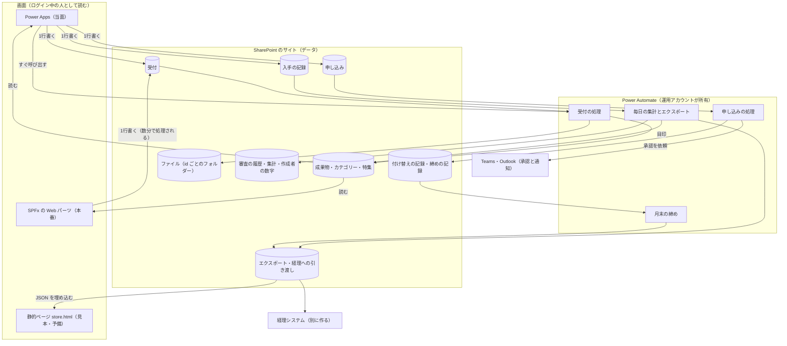
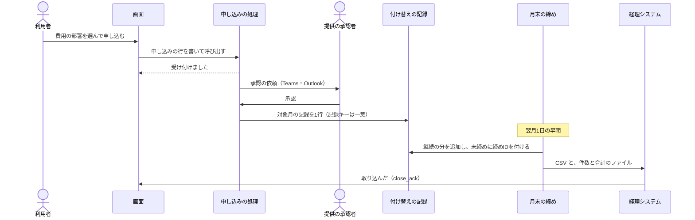

# 成果物のストア — バックエンドの構成

試作は、ブラウザの中だけで完結している。公開・審査・入手・申し込みの結果は、そのブラウザの `localStorage` にだけ残る。ログインの仕組みは無く、「あなた」は仮の名前で、審査担当者の役割は自分で切り替えられる。
バックエンドを作るとは、これらを **組織で共有される実際のデータと権限** に置き換えることである。

この文書では、その構成を決める。データの列と型は [data-model.md](data-model.md) に、作る順番は [implementation-guide.md](implementation-guide.md) に書いた。

**仕様・上限・ライセンスの記述は、この文書を書いた AI（Claude）の学習済みの知識に基づく。** そうした箇所には **［要確認］** を付け、確認方法を添えた。
T01〜T25 の番号は [implementation-guide.md の「導入先で確かめること」](implementation-guide.md#導入先で確かめること) の確認項目を指す。

---

## 1. 結論

| 方式 | いつ選ぶか | 概要 |
|---|---|---|
| **Microsoft 365 方式（勧める方式）: Microsoft 365 だけで作る** | サーバーを持てず、バージョン管理の基盤も無い組織（この文書の前提） | データは SharePoint のリストとライブラリに置く。書き込みは「受付のリストに 1 行 → フローが確かめて反映」の形にする。画面は、当面は Power Apps、本番は試作の画面を載せた SPFx の Web パーツ |
| Git 方式: Git の基盤がある | 組織に GitHub Enterprise か Azure DevOps があり、全員がアカウントを持つ | 成果物 1 件を 1 つの JSON ファイルとして Git に置き、公開と昇格をプルリクエストで進める。有償の申し込みと付け替えは Git に置けないので Microsoft 365 側に残す（18 章） |
| サーバー方式: サーバーを持てる | Azure のサブスクリプションか社内のサーバー 1 台を用意でき、Web アプリを保守する人がいる | Entra ID でサインインする小さな Web アプリ。画面は試作の HTML をほぼそのまま使い、API とデータベースを加える（19 章） |

**Microsoft 365 方式を勧める理由:**

1. 前提（サーバーを持てない、バージョン管理の基盤が無い、作るのは業務担当）の下で成り立つのは、この方式だけである。
2. 使うコネクタと機能は、標準のライセンスの範囲に収まる見込みである。プレミアムのコネクタ（HTTP、Dataverse、カスタムコネクタ）は使わない［要確認: T04］。
3. 書き込みを 1 つの形（受付の 1 行 → フロー）にそろえるので、画面を Power Apps から SPFx に替えても、フローと検証の処理はそのまま使える。
4. データの形は試作の `catalog.json` と同じく 1 件 1 レコードのままで、エクスポートした JSON は試作の画面にそのまま読み込める。前提が変わったら、ほかの方式へ移行できる（20 章）。

---

## 2. 全体図

読み取りは、画面がログイン中の人の権限で直接行う。
書き込みは、画面が受付・申し込み・入手の記録のいずれかに 1 行書くだけである。それ以外への書き込みは、運用アカウントが所有するフローだけが行う。

---

## 3. 部品と役割

| 部品 | 使うもの | 役割 | IT 管理者の作業 | ライセンス |
|---|---|---|---|---|
| ストアのサイト | SharePoint Online のコミュニケーションサイト 1 つ | リストとライブラリを置く場所。閲覧者は組織の全員 | 利用者がサイトを作れない設定なら、SharePoint 管理者に作ってもらう［要確認: SharePoint 管理センターの設定で、サイトの作成が許されているか］。リスト・列・権限はサイトの所有者が作れる | 標準の Microsoft 365 |
| データの置き場 | リスト 17、ライブラリ 7（段階 1 で作るのはリスト 6 とライブラリ 1） | [data-model.md](data-model.md) 2 章 | 不要 | 標準 |
| 画面（当面） | Power Apps のキャンバスアプリ。SharePoint のページ（Power Apps の Web パーツ）と Teams のタブに埋め込む［要確認: T19］ | 探す・詳細・入手・申し込み・公開・公開した成果物・審査待ち・ストア管理 | 既定の環境で作れる設定なら不要［要確認: T02］。組織の全員に共有できるか［要確認: T19］ | 標準のコネクタだけなら、Microsoft 365 に含まれる利用権で足りるはず［要確認: T04］ |
| 画面（本番） | SharePoint Framework（SPFx）の Web パーツ。中身は試作の CSS と JS で、読み書きの部分だけを SharePoint の REST に差し替える | 試作と同じ見た目と操作 | 必要。アプリカタログへの配置と承認［要確認: T20］。開発者の PC に Node.js の開発環境 | 追加は不要のはず［要確認: T20 で SharePoint 管理者に聞く］ |
| フロー | Power Automate のクラウドフロー。コネクタは SharePoint、承認、Microsoft Teams、Office 365 Outlook、Office 365 ユーザーと、組み込みの操作だけ | 受付の処理、申し込みの処理と承認、毎日の集計とエクスポート、月末の締め、監視 | 構築担当者が作れる。運用アカウントを所有者にするなら、アカウントの作成を依頼する | 標準のコネクタだけなら Microsoft 365 の利用権で足りるはずである［要確認: T04］。1 日の要求数に上限がある［要確認: T17］ |
| 承認 | Power Automate の「承認」コネクタ。回答は Teams の承認アプリ・Outlook・Power Automate の画面から行う | **申し込みの承認だけ**に使う（審査の判定は画面の中で行う。理由は 6.4） | 初めて使うとき、環境に承認の仕組みが準備されるはず［要確認: T10］ | 標準のはずである。裏で Dataverse を使うが、利用者にプレミアムのライセンスは不要のはず［要確認: T10］ |
| 運用アカウント | Entra ID のユーザー アカウント 1 つ（人ではなく役割のためのもの。いわゆるサービス アカウント） | フローと接続の所有者。成果物・ファイル・付け替えの記録に書き込めるのはこのアカウントだけ | 必要。アカウントの作成、ライセンス、パスワードと多要素認証の扱い（16 章） | Microsoft 365 のライセンスが 1 つ必要なはず［要確認: Microsoft 365 管理センター＞ユーザー＞運用アカウント＞ライセンスとアプリで、Power Automate の標準の利用権を含むプランが付いているかを見る。T05 をそのアカウントの接続で試す］ |
| サインインと役割 | Entra ID のシングルサインオン、Office 365 ユーザー（名前・部署・上司を取得する）、役割のリスト | 「あなた」はサインインで決まる。審査担当者・ストア管理者・経理担当は役割のリストで決まる | 部署の項目が埋まっているかを聞く［要確認: T14］ | 標準 |
| 通知 | Teams（チャットかチャネルへの投稿）と Outlook（メール） | 公開、審査の申請、承認・差し戻し、申し込みへの回答、締めの完了、処理の停止を知らせる | フローから Teams に投稿できるか［要確認: T13］ | 標準 |
| 静的ページ | `store-template.html` に、エクスポートした JSON を埋め込んだ `store.html` | 完成形を見せる見本と、ほかの画面が使えないときの予備。データを持ち出せることの確認 | 不要。SharePoint 上では開けず、ダウンロードになる［要確認: T01］ | 標準 |
| 経理システム | **この文書の対象外。別に作る** | 締めた付け替えのファイルを取り込み、計上する | — | — |

---

## 4. データの置き場（要約）

詳しくは [data-model.md](data-model.md) を参照。ここには考え方だけを書く。

- **公開してよいものと、そうでないものを、リストで分ける。** 成果物のリストには、誰に見られてもよい列だけを置く。差し戻しの理由、入手の数、申し込み、付け替えは別のリストに置く。
- **権限はリストとライブラリの単位で決める。アイテムごとの権限は作らない。** アイテムごとに分けると、数が増えたときに管理しきれず、固有の権限（個別に設定した権限）の数の上限にも近づく［要確認: 1 リストあたりの上限と推奨値を管理者に聞く］。
- **「自分の行だけ読める」リスト**（受付、入手の記録、申し込み、作成者の数字）は、リストの詳細設定「アイテムレベルのアクセス許可」で作る。これはリスト単位の設定であり、アイテムごとの権限ではない［要確認: T08］。利用者は、受付では自分の行を編集できるが、ほかの 3 つでは作成できるだけで編集はできない（7.2）。
- **ファイルは `/<id>/` に置く。** 区分をパスに含めないので、昇格してもリンクが切れない。
- **インデックスは最初から付ける。** リスト ビューのしきい値を超えてからでは付けられないことがある［要確認: T15］。

---

## 5. 書き込みの共通の形

### 5.1 基本の形

画面からの書き込みは、すべて同じ形にする。

1. 画面が、ログイン中の人として **受付のリストに 1 行** 書く（申し込みは申し込みのリスト、入手は入手の記録に書く）。
2. フローが、その行を **検証して** から、成果物やファイルや記録に **反映** する。
3. フローが、結果を同じ行に書き戻し、通知する。

**この形にする理由:**

- **検証をフローに集約できる。** 成果物のリストに書き込めるのは運用アカウントだけなので、画面を迂回して SharePoint の画面や REST から受付に書き込まれても、同じ検証を通る。
- **画面を替えても変わらない。** Power Apps でも SPFx でも、書き込み先は同じ受付の行である。
- **記録が残る。** 誰がいつ何を求め、どうなったかが、受付の行と操作の記録に残る。

### 5.2 フローの起動方法（反映の速さ）

| 画面 | 起動方法 | 公開までの時間 | 理由 |
|---|---|---|---|
| **Power Apps（当面）** | 画面が行を書いた直後に、**Power Apps (V2) トリガー** でフローを直接呼び出す。フローは「PowerApp またはフローに応答する」で結果を返す | 数秒〜十数秒 | 標準のトリガーのはずである［要確認: T05］。SharePoint のトリガーは一定の間隔で変更を確認する仕組みのため、数分かかる［要確認: T07］ |
| **SPFx（本番）** | 画面が行を書く。フローは SharePoint の「項目が作成されたとき」で起動する。画面は行を数秒おきに読み直し、「公開しています」と表示する | 数分［要確認: T07］ | SPFx からフローを直接呼び出すには「HTTP 要求の受信時」トリガーが必要で、プレミアムになる［要確認: Power Automate のフローの作成画面で、このトリガーに「プレミアム」のラベルが付いているかを見る］ |

- 処理の手順は同じで、トリガーだけが違う。**同じ手順を 2 つのフローに重複して持たない。** SPFx に移るときは、トリガーを差し替える。両方を並行して使う期間があるなら、手順を子フローに分ける［要確認: 既定の環境でソリューションと子フローが使えるか］。
- Power Apps が呼び出したフローの応答を待てる時間には上限がある（120 秒前後のはず［要確認: T06］）。フローは検証と反映を先に済ませてから応答を返し、通知は応答の後に送る。
- 呼び出しが失敗した行は「未処理」のまま残る。**監視のフロー**（15 分ごと）が、作成から 10 分を過ぎた未処理の行を見つけてストア管理者に通知する。ストア管理者は管理画面の「処理し直す」で、同じフローを代わりに呼び出す（6.16）。

### 5.3 誰の操作かを確かめる

- フローが「誰の操作か」の根拠として信頼するのは、**行の登録者（Created By）** と、**Power Apps (V2) トリガーが渡す「呼び出した人」**（トリガーの出力のヘッダー `x-ms-user-email`）の 2 つだけである。入力欄に書かれた名前や部署は使わない。
- Power Apps から呼び出されたときは、この 2 つが同じ人かを照合する。比べるのはメールアドレスの文字列ではなく、Entra ID から取得したオブジェクト ID である（サインイン名とメールアドレスが異なる組織があるため。手順は implementation-guide.md 段階 4 の 1）。一致しなければ処理しない。これにより、ほかの人の行の番号を渡されても処理は動かない。ただし、ストア管理者が「処理し直す」で呼び出したとき（呼び出した人が役割のリストの `store_admin`）は照合せず、登録者を操作した人として処理を続け、処理し直した人を操作の記録に書く。
- 登録者は SharePoint が設定する値で、画面の入力欄からは変えられない。ただし、**投稿の権限を持つ人が REST の特別な呼び出しで登録者を書き換えられるかどうかは、はっきりしない**［要確認: T09］。
  - T09 で書き換えられないと分かれば、SPFx の経路（誰の操作かは登録者だけで決まる）も同じ検証で足りる。
  - 書き換えられると分かれば、**書き込みは Power Apps (V2) の経路に限る**（呼び出した人と登録者を照合できるため）。SPFx の画面の書き込みボタンは、該当する Power Apps の画面を開く。監視のフローは、照合できない行を処理せずストア管理者に回す。
- 名前・部署・上司は、フローが Office 365 ユーザーのコネクタで Entra ID から取得する。

### 5.4 重複を防ぐ

| 仕組み | 何を防ぐか |
|---|---|
| 画面は、送信したらボタンを押せなくする | 二度押し |
| 画面がフォームを開いたときにランダムな値（`ClientToken`）を作り、行に入れる。同じ値の 2 行目は `duplicate` にする | 二度押しで 2 行できたとき |
| 同じ人が同じ名前で `DuplicateWindowMinutes`（既定 10 分）以内に公開したら、2 件目を `duplicate` にして 1 件目の id を返す | 画面を開き直して再送信したとき |
| 成果物の `SourceRequestId`（元の受付の行）に一意制約を付ける | フローが同じ行を二度処理したとき |
| 行の `ProcessState` が `new` でなければ、フローは結果を返すだけで何もしない | 直接の呼び出しと、処理し直しが重なったとき |

**一意制約に違反すると、フローの操作は失敗する。** 既定の設定では、そこで実行全体が止まる。そのため重複は、作成の前に「複数の項目の取得」で同じキーを探して避け、無いときだけ作成する。一意制約は最後の安全策とする。

### 5.5 読み出しの件数

- フローの「複数の項目の取得」は、上位の件数を指定しないと既定で 100 件しか返さないはずである［要確認: テスト用のリストに 150 行を作る。上位の件数を空にして取得し、返った件数を見る］。
- どのフローでも、上位の件数を 5000 にする。操作の設定で「改ページ」を有効にし、しきい値を入れる（パフォーマンス プロファイルが「低」なら 5,000 まで［要確認: T17］）。
- 締めと毎日の集計では、取得した件数を実行履歴に残す。件数がしきい値に達したら処理を止め、ストア管理者に通知する（データが欠けたまま、知らせずに処理を続けない）。

---

## 6. 操作ごとの流れ

各操作について、「きっかけ」「手順」「誰に何が見えるか」「判断の理由」を書く。

### 6.1 公開

**きっかけ:** 利用者が公開のフォームに入力し、「インディーズに公開する」（「審査を申請」をオンにしたときは「公開して審査を申請する」）を押す。

1. 画面が受付に `publish` の行を書く。入力内容（名前、サブタイトル、概要、詳しい説明、カテゴリー、無償か有償か、対応環境、参考にした成果物、審査を申請するか）とファイル（行の添付）を入れる。**有償なら、金額と単位に加えて「収入の計上部署」のコード（部署コードの一覧から選ぶ）と、任意で「申し込みを承認する人」（収入の部署の人に限る）** を入れる。
2. 画面は同時に、作成者の数字のリストに自分の行が無ければ 1 行作る（8 章）。
3. 画面がフローを呼び出す（Power Apps (V2)）。
4. フローが誰の操作かを確かめ（5.3）、行を `processing` にする。
5. 重複を確認する（5.4）。
6. 内容を検証する。`build_store.py` の検査と同じ規則（中カテゴリーがある、参考にした成果物が実在する、有償なら金額と単位がある）に加えて、文字数（名前 45、サブタイトル 20、概要 60）と、**有償なら収入の部署のコードが部署コードの一覧にあり、有効期間内であること**を確かめる。**収入の部署のコードは、初期設定では作成者の部署のコード（Entra ID の部署が一覧の `DirectoryDept` と一致するもの）に限る。** ほかの部署のコードのときは、その部署の `CostApprovers`（空ならストア管理者）に「収入の部署として登録してよいか」の承認を依頼し、画面には `requested`（承認待ち）を返す。承認されたら 7 以降に進み、断られたら `rejected` にする。待つのは `ApplyWaitDays` まで。承認されるまで成果物は公開されない（ほかの部署を、その部署の知らないうちに収入の部署にしないため）。申し込みを承認する人を入れたときは、その人が収入の部署の人（Entra ID の部署が、収入の部署のコードの `DirectoryDept` と一致する人）かを確かめる（8.3）。検証を通らなければ、`rejected` と理由を書いて返す。
7. id を採番する（[data-model.md](data-model.md) 9 章）。
8. 成果物のリストに 1 行作る。`Tier`＝`indie`、`ReviewStatus`＝`none`、`ItemVersion`＝`1.0`、`Updated` と `PublishedAt`＝今日、`State`＝`listed`。`MakerId`・`MakerUpn`・`MakerName`・`MakerOrg` は登録者と Entra ID から取得する。
9. 添付を `/<id>/` に移す（有償なら有償のファイルのライブラリへ）。`Files` を書く。受付の行の添付を削除する。
10. 受付の行に `published` と id を書き戻す。操作の記録に 1 行書く。
11. 審査を申請するなら、続けて 6.3 の手順に進む。
12. 画面に id を返す。画面は詳細画面（`#/item/<id>`）へ移り、「インディーズに公開しました」（審査を申請したときは「公開し、審査を申請しました」）と表示する。
13. 作成者に Teams で通知する（応答の後）。

**誰に何が見えるか:** 受付の行を見られるのは、作成者とストア管理者だけ。公開した成果物は、インディーズとしてすぐに全員に見える。

**判断の理由:** 試作では入力を終えた瞬間に公開される。これに近づけるため、フローを直接呼び出して数秒で公開する（R2）。検証をフローで行うので、画面を迂回しても不正な内容は通らない。

### 6.2 バージョンの更新と取り下げ

**きっかけ:** 作成者か保守担当者が「新しいバージョンを出す」か「取り下げる」を押す。作成者とストア管理者は「担当を変える」も押せる。

1. 画面が受付に `update`・`withdraw`・`maintainers` のいずれかの行を書き、フローを呼び出す。
2. フローが、登録者が成果物の `MakerId` か `Maintainers` に含まれるかを確認する（取り下げと担当の変更はストア管理者も行える。担当の変更は、保守担当者からは申請できない）。含まれなければ `rejected` にする。有償の入力内容には、6.1 の 6 と同じ検証を行う（収入の部署をほかの部署に変えるときの承認も同じ）。
3. **インディーズの更新:** 列を書き換え、`ItemVersion` と `Updated` を更新し、ファイルを置き換える。前のファイルはバージョン履歴に残る。
4. **オフィシャルの更新:** すぐには反映しない。フローは、入力内容を審査待ちのリスト（`PendingUpdates`）にコピーする。このリストを読めるのは審査担当者とストア管理者、書き込めるのは運用アカウントだけ。新しいファイルは、審査待ちのライブラリ（`PendingFiles/<id>/<版>/`）に移す。このライブラリを読めるのは審査担当者とストア管理者である。そのうえで審査の申請（6.3）に進む。承認されたら、このコピーから反映する。受付の行が後から編集されても、その値は使わない（仮の決定。[data-model.md](data-model.md) 10 章）。
5. **参考にした成果物は、追加だけを受け付ける。** 削除はストア管理者が行う（参考にした成果物とのつながりを消させないため）。
6. **取り下げ:** `State` を `withdrawn` にする。行もファイルも削除しない。一覧と検索から外れ、ほかの成果物の「参考にした成果物」には「取り下げ済み」と表示される。有償なら、利用中の申し込みはその月で終了とし（6.12）、申込者と提供側に通知する。確定前の申し込み（`received`・`cost_approval`・`provider_approval`）は `cancelled` にして、申込者に通知する。依頼中の承認に後から回答が返っても、何も変えない（6.8）。審査の申請中なら、昇格の申請では `ReviewStatus` を `none` に戻し、更新の申請では審査待ちの更新を `cancelled` にする。どちらの場合も、審査の履歴に `Outcome`＝`cancelled` を 1 行書く。
7. **担当の変更:** 成果物の `Maintainers` と `ProviderApprovers` を書き換える。申し込みを承認する人は、収入の部署の人に限る（6.1 の 6、8.3）。
8. 結果を書き戻し、通知する。

**誰に何が見えるか:** 変更の前後はリストとライブラリのバージョン履歴と操作の記録に残り、ストア管理者が確認できる。利用者には新しいバージョンと更新日だけが見える。

### 6.3 審査の申請

**きっかけ:** 作成者か保守担当者が「審査を申請する」を押す。公開のときに「審査を申請」をオンにしていた場合も、これにあたる。

1. 画面が受付に `review_request` の行を書く（公開と同時なら、公開のフローの続きで扱う）。
2. フローが次を確認する。申請した人が作成者か保守担当者であること。現在インディーズであること（オフィシャルの更新の審査を除く）。`ReviewStatus` が `requested` でないこと。
3. インディーズからの昇格なら、成果物の `ReviewStatus` を `requested`、`ReviewAt` を今日にする。詳細画面に「審査を申請中（日付）」と表示される。**オフィシャルの更新の審査なら、成果物の `ReviewStatus`・`ReviewAt`・`ReviewBy`・`ReviewNote` を変えない。** 承認済みの記録はそのまま残す（詳細画面の審査済みの日付が、申請日に変わらないようにするため）。申請中であることは、審査待ちの更新の `State`＝`pending` と、受付の `update` 行の `Result`＝`requested` だけで表す。
4. 受付の行の `Result` を `requested`（判定待ち）にする。差し戻しの理由は、後でこの行に書き戻す。
5. 役割のリストの審査担当者に Teams で通知する。申請した人が審査担当者であっても、自分の成果物の通知の宛先からは外す。
6. 毎日の監視（6.16）が、`ReviewWaitDays`（既定 30 日）を過ぎた申請を期限切れにする。昇格なら `ReviewStatus` を `none` に戻す。更新なら審査待ちの更新を `expired` にし、成果物には書かない。作成者とストア管理者に通知する。

**誰に何が見えるか:** インディーズからの昇格を申請中であることは、全員に見える。オフィシャルの更新の申請は利用者には見えず、承認済みのバージョンが公開され続ける。審査担当者の審査待ちの一覧は、成果物の `ReviewStatus`＝`requested`（昇格）と、審査待ちの更新（`PendingUpdates` の `State`＝`pending`）の 2 つから作り、申請の古い順に並べて、申請からの経過日数を表示する。更新の内容とファイルは、審査待ちのリストとライブラリで読む（受付は「自分の行だけ」なので、審査担当者は受付を読めない）。有償の成果物のファイルも、審査担当者は読める（7.2）。

### 6.4 承認

**きっかけ:** 審査担当者が、「審査待ち」の画面で 1 件を開き、コメントを書いて「承認する」を押す。

1. 画面が受付に `review_decision` の行（`TargetId`＝成果物の id、`Decision`＝`approve`、`Note`＝コメント）を書き、フローを呼び出す。
2. フローが次を確認する。登録者が役割のリストの審査担当者（`Active`＝`yes`）であること。登録者が、その成果物の作成者でも保守担当者でもないこと。成果物の `ReviewStatus` が `requested` であること（オフィシャルの更新なら、審査待ちの更新の `State` が `pending` であること）。
3. インディーズからの昇格なら、成果物を `Tier`＝`official`、`ReviewStatus`＝`approved`、`ReviewAt`＝今日、`ReviewBy`＝役割の名前、`ReviewNote`＝コメント にする。オフィシャルの更新なら、`ReviewAt`・`ReviewBy`・`ReviewNote` だけを新しい承認の内容で書き換える。
4. **id、`PublishedAt`、`References`、ファイルのフォルダー、入手の記録は変えない。** 参考にした成果物とのつながりも、目印の集計も、そのまま続く。
5. オフィシャルの更新の審査だったときは、審査待ちのリストのコピーから反映する（6.2 の 3 と同じ書き換え。ファイルは `PendingFiles/<id>/<版>/` から `/<id>/` に移す）。審査待ちの更新を `approved` にする。
6. 審査の履歴に 1 行書く（判定した人、日時、コメント）。作成者の申請の行に `approved` を書き戻す。
7. 作成者に通知する。

**誰に何が見えるか:** 全員に、オフィシャルに移ったことと、承認日とコメント（詳細画面の「ストアによる確認」）が見える。判定した人の名前は審査の履歴にだけ残り、審査担当者とストア管理者が見る。全員が見る画面には役割の名前だけを表示する。

**判断の理由（なぜ承認のコネクタではなく画面の中で判定するか）:**

- 試作と同じく、審査画面の操作バーでコメントを書いてから判定できる。**差し戻しのコメントを画面で必須にでき、フローでも空のコメントを拒否できる。** 承認のコネクタではコメントを必須にできないはずで［要確認: T11］、承認を依頼し直す回り道が必要になる。
- 審査待ちの一覧の元になるデータは、成果物のリスト（全員が読める）と審査待ちのリスト（審査担当者が読める）にあるので、審査担当者の画面からそのまま読める。
- 長時間待機するフローが無くなり、1 回の実行の上限日数（30 日のはず［要確認: T11。Power Automate の上限のドキュメントを Power Platform 管理者と見る］）に達しない。
- 同じ成果物を 2 人が同時に判定したら、後の人の行は `ReviewStatus` が `requested` でなくなっているので `rejected`（「すでに判定済み」）になる。画面はデータを読み直して、その旨を表示する。

### 6.5 差し戻し

**きっかけ:** 審査担当者が理由を 1 行書いて「差し戻す」を押す。

1. 画面は、コメントが空なら「差し戻す」を押せなくする。画面が受付に `review_decision`（`Decision`＝`return`）の行を書き、フローを呼び出す。
2. フローは、コメントが空なら `rejected` にする（画面を迂回されても通さない）。そのほかの確認は承認と同じ。
3. インディーズからの昇格なら、成果物の `ReviewStatus` を `none` に戻す。インディーズのまま公開が続く。**`returned` は成果物のリストに書かない。** **オフィシャルの更新を差し戻したときは、成果物に何も書かない。** 承認済みのバージョンのまま公開が続く。審査待ちの更新を `returned` にする。
4. 作成者の申請の行に `returned` と理由（`ResultNote`）を書き戻す。審査の履歴に 1 行書く。
5. 作成者に Teams とメールで理由を送る。
6. 作成者は「公開した成果物」で理由を確認し、修正してから「再申請する」を押す（新しい受付の行になる）。

**誰に何が見えるか:** 理由を見られるのは、作成者（自分の申請の行と通知）と、審査担当者とストア管理者（審査の履歴）だけである。利用者の画面にもデータにも、差し戻しは現れない。

**審査担当者に伝える文面:** 審査画面の操作バーに「承認のコメントは成果物の詳細ページに公開されます。差し戻しのコメントは作成者にだけ届きます」と常に表示しておく。

### 6.6 入手（無償のもの）

**きっかけ:** 利用者が詳細画面や一覧で「入手」を押す。フローは動かない。

1. 画面が、自分の入手の記録にその成果物の行があるかを確認する。無ければ 1 行書く（`Title` と `ItemId` に成果物の id、`ItemVersion`）。
2. ファイルが 1 つなら、そのファイルをダウンロードさせる。複数ならフォルダーを開く［要確認: Power Apps の Download・Launch で SharePoint のファイルがダウンロードになるか］。
3. ボタンを「入手済み」（ツールは「開く」）に変える。状態は自分の入手の記録から読むので、別の端末でも同じ表示になる。入手の記録は `RawKeepDays`（既定 90 日）を過ぎると削除されるので、その後はボタンが「入手」に戻る（仮の決定）。もう一度押すと新しい 1 行になる。入手の数に入るかどうかは、6.13 の 3 の数え方による。ボタンを戻したくない組織は、`RawKeepDays` を長くするか、行を削除しないようにする（21 章の問い。管理側から見える期間が延びるので、8.3 の約束の文面も合わせて変える）。
4. HTML で動く成果物は、ダウンロードとして渡す。SharePoint 上ではブラウザで開けない［要確認: T01］ので、詳細画面の「対応環境」に「ダウンロードして開く」と書き、「開く」はダウンロードして開くための案内にする。ストアと同じ場所で開かせないことは、成果物の中のスクリプトが、ストアの画面を操作するのを防ぐうえでも望ましい。
5. 毎日の集計フローが、後でこの行を読み取る。

**誰に何が見えるか:** 誰が何を入手したかを示す行は、入手した人自身とストア管理者だけが見られる。作成者にもほかの利用者にも、名前は表示されない。

### 6.7 申し込み（有償のもの）

**きっかけ:** 利用者が金額のボタンを押す。

1. 画面が「利用の申し込み」のシートを表示する。シートには金額、単位、作成者、提供部署（成果物の「収入の計上部署」）、申込者を示し、**「費用の計上部署」の入力欄** を置く（部署コードの一覧から候補を表示する。初期値は、Entra ID の部署と一覧の `DirectoryDept` が一致するコード）。提供側へのコメントは任意で書ける。
2. シートの説明文は、試作と同じ次の文にする。「提供部署が承認すると、選んだ部署の費用として自動で付け替えます（月末締め・翌月度計上）。経理の手続きは不要です。」継続の単位なら「解約するまで毎月付け替えます」を加える。以前の試作にあった、部署を選ぶ操作が無い前提の説明文は使わない。
3. 「申し込む」を押すと、画面が申し込みのリストに 1 行書く（`ItemId`、`CostDeptCode`、`Message`、`ClientToken`。`Title` にも `ClientToken` を入れる）。ボタンは「申し込み中」になる。利用者はこの行を後から編集できない（7.2）。
4. 画面が申し込みの処理のフローを呼び出す。フローは検証（下記）を済ませて「受け付けました」を返し、そのまま承認を待つ手順に進む［要確認: 応答の後もフローが続くことを試す］。
5. フローの検証:
   - 誰の操作かを確かめる（5.3）。
   - 成果物が有償で、`State`＝`listed` であること。自分の成果物（または自分が保守担当者である成果物）ではないこと。
   - `CostDeptCode` が部署コードの一覧にあり、`Active`＝`yes` で、有効期間内であること。
   - 同じ人・同じ成果物の申し込みが、確定前（`received`・`cost_approval`・`provider_approval`）、利用中（`active`・`joined`）、買い切りで完了済み（`completed`）のいずれかなら `duplicate` にする。買い切りをもう一度購入する必要があるときは、ストア管理者が受け付ける。
   - **単位が、部署で 1 件の申し込みとして扱うもの（`DeptScopeUnits`。例: 「1部門あたり月額」）で、同じ成果物・同じ費用の部署の申し込みがすでに利用中なら、`joined` にしてその申し込みに加える。** 新しい承認も付け替えも作らず、ファイルを届けて提供側に通知するだけにする。加わる条件は、費用の部署のコードが同じで、かつ費用側の承認が不要である（`CostApproval` の判定で、申込者の部署とみなせる）こと。承認が必要なときは、加わる前に費用側の承認を依頼する（ほかの部署のコードを入力して、その部署の同意なしに加わることを防ぐため）。
   - **費用の部署と収入の部署が同じなら、** 承認は取るが、付け替えの記録は作らない（同じ部署内の付け替えは意味が無いため）。
6. 申し込み ID を採番し、金額と単位と収入の部署のコードを **成果物から改めて取得して申し込みに書き込む**（画面の値は使わない）。申込者の部署も Entra ID から取って書き込む。`Billing` と `Scope` を単位から決める。
7. 6.8 の承認へ進む。

### 6.8 申し込みの承認（提供してよいか）

1. **費用側の承認（設定 `CostApproval`）:** 既定は `other_dept`。申込者の Entra ID の部署と、入力した費用の部署のコードが対応しないときだけ、その部署の承認者（部署コードの一覧の `CostApprovers`、空なら申込者の上司）に承認を依頼する。`never` なら承認を挟まない。`always` なら常に挟む。断られたら `declined` にする。
2. **提供側の承認:** 成果物の `ProviderApprovers`（空なら作成者）に承認を依頼する。回答の選択肢は「承認」「断る」。最初に回答した 1 人で決まる形にする［要確認: T11］。依頼の本文には、申込者の名前と部署、費用の部署のコードと名前、成果物、金額と単位、コメントを入れる。
3. 待つ期間は、申し込みの日から合計で `ApplyWaitDays` の日数まで（既定 14 日、上限 28 日。1 回の実行の上限 30 日［要確認: T11］に達しないため）。提供側の承認の期限は、費用側の承認を待った日数を差し引いた残りとする。期限は、承認の操作の設定の「タイムアウト」に入れる。式を入れられないときは、承認を「作成」と「待機」の 2 つの操作に分け、並列の分岐に「待ち時間」を置いて、先に終わった方で決める［要確認: T11 で、タイムアウトに式（例 `concat('P', <設定の値>, 'D')`）を入れて保存できるかを見る］。期限が切れたら `expired` にして双方に通知する。実行が打ち切られて待機状態のまま残った申し込みは、毎日の監視が拾う（6.16）。
4. **承認:** 申し込みを、継続なら `active`（`StartMonth`＝承認した月）、買い切りなら `completed` にする。承認した人と日時を書く。**付け替えの記録を 1 行作る**（6.9）。有償のファイルを申込者にメールの添付で届ける。添付の上限を超えるものはストア管理者に回す［要確認: T12］。入手の数に 1 件加える。
5. **断る:** `declined` と理由を書き、申込者に通知する。ボタンの表示は元の金額に戻る。

**回答が遅れて返ったとき:** 承認の回答が返ったら、まず申し込みと成果物を読み直す。申し込みがすでに待機状態でない（取りやめ・期限切れ）か、成果物が取り下げられていれば、何も変えず、回答した人に「取りやめ済み」と通知する。

**判断の理由（誰が承認するか）:**

- **提供側の承認を初期設定で必須にする。** 収入を受け取る側が「この部署に提供してよいか」を決めるのが筋であり、提供に責任を持つのもその部署だからである。初期設定の承認者を作成者にするのは、有償で公開した人が、その部署の担当として内容を最もよく知っているためである。部署で決まった担当者に任せたいときは、公開のときに「申し込みを承認する人」を入れる。
- **費用側の承認は、初期設定では「自分の部署以外のコードを入れたとき」だけ挟む。** 自分の部署の費用にするなら、部署内で後から確認できるので、手間を増やさない。ほかの部署の費用にするには、その部署の同意が必要である。Entra ID の部署と部署コードの一覧が対応しない人は「自分の部署以外」とみなす（誤った部署に付け替えるより、承認が 1 つ増える方がよい）。常に挟むか、まったく挟まないかは導入先が決める。
- **申し込みの承認には承認のコネクタを使う。** 承認待ちの申し込みの一覧は申込者の名前を含むので、全員には見せられない。承認のコネクタなら、判断する人にだけ届き、回答した人が確実に記録され、Teams や Outlook から回答できる（ストアを開かなくてよい）。承認が環境で使えないときの代替策は T10 を参照。

**誰に何が見えるか:** 申込者は自分の行（状態と回答）を見られる。承認者は、承認依頼の通知で申込者を知る。ストア管理者はすべての行を見られる。経理担当は付け替えの記録だけを見る（名前は含まれない）。

### 6.9 付け替えの記録

申し込みが承認されると、フローが自動で付け替えの記録を作る。利用者も作成者も、経理の操作はしない。

| 単位 | いつ作るか | 記録キー | 対象月 |
|---|---|---|---|
| 買い切り（`once`） | 承認時に 1 行 | `<申し込み ID>-ONCE` | 承認した月 |
| 継続（`monthly`） | 承認時に、承認した月の分を 1 行。以後は **月末の締めで、利用中の月ごとに 1 行** | `<申し込み ID>-<対象月>` | その月 |

- 金額は、申し込みに記録した金額 × 数量 1。**日割りはしない**（6.12）。
- 対象月は **提供側が承認した日時（日本時間）** で決める。フローが行を書いた時刻ではない（月末深夜の承認が翌月にずれないようにするため）。
- 記録キーには一意制約を付ける。同じ申し込みの同じ月は 2 行作れない。一意制約に違反すると、フローの操作は失敗する。重複は作成前に探して避け、一意制約は最後の安全策とする（5.4）。
- 費用の部署と収入の部署のコードと名前、成果物の名前は、その時点の値を記録しておく。
- `State` は `open`（未締め）で作る。
- 継続の申し込みで毎月作る行では、収入の部署を申し込みの `RevenueDeptCode` から取る。作成者がバージョンの更新で収入の部署を変えたときは、フローが利用中の申し込みごとに、今月の分の記録（`<申し込み ID>-<今月>`）がまだ無ければ元のコードで作ってから、申し込みの `RevenueDeptCode` を書き換え、提供側に通知する。そのため、翌月の分から新しいコードになる。
- 対象にするのは、最終更新者が運用アカウントである申し込みだけ（利用者が作成したままの行は信頼しない。[data-model.md](data-model.md) 7.3）。

### 6.10 月末の締めと経理への引き渡し

**きっかけ:** 毎日早朝に定時実行するフロー。今日が `CloseDay`（既定 1 日）以降で、先月分をまだ締めていなければ動く。ストア管理者が手動で起動する経路も作る（1 本のフローにトリガーは 1 つなので、締めの手順を子フローにする。implementation-guide.md 段階 7 の 3）。

1. 締める月を決める。締めの記録で `done` になっている計上月度のうち最も新しいものの翌月から今月までを、古い順に 1 か月ずつ締める。各月について、M＝その計上月度の前月、締め ID＝`CLOSE-<その計上月度の YYYYMM>` とする（日本時間）。通常は今月の 1 か月だけになる。締めが 1 か月まるごと動かなかったときも、抜けた月の継続の分が月ごとに作られる。
2. 締めの記録に同じ計上月度の行があれば、`State` で処理を分ける。`done` なら何もせず終わる（**1 か月に 1 回だけ**）。`running` なら、ストア管理者に通知して止まる（二重に動かさないため）。`failed` なら、その行を `running` に戻して 4 から続ける（計上月度は一意なので、新しい行は作らない）。
3. 行が無ければ、締めの記録に行を作る（`running`）。
4. **継続の分を作る:** 申し込みのうち、`active` のもの、または `ended` で `EndMonth` が M 以降のもので、かつ `StartMonth` が M 以前のものについて、`<申し込み ID>-<M>` の記録を作る。`on_hold` の申し込みと、最終更新者が運用アカウントでない申し込み（[data-model.md](data-model.md) 7.3）については作らない。すでにある記録も作らない。作成前に「複数の項目の取得」で探し（フィルター `Title eq '<記録キー>'`、上位の件数 1）、無いときだけ作成する（承認した月の分は承認時に作られているので、ここでは作られない）。一意制約は最後の安全策として残す。「項目の作成」の次の操作は、「実行条件の構成」で「失敗した」ときも実行されるようにする。失敗の理由が値の重複のときだけ飛ばして次へ進み、それ以外の失敗は失敗時の分岐へ送る［要確認: テスト用のリストで同じ `Title` の行を 2 回作る。2 回目の失敗の本文に、値が重複している旨が出るかを見る］。
5. **締める行を集める:** `State`＝`open` で、対象月が M 以前の行を集める（遅れて届いた先月以前の分も含む）。件数の扱いは 5.5 のとおり。
6. **検証する:** 費用と収入の部署のコードが、部署コードの一覧で有効期間内かを確認する。期間外なら `held` にして理由を書き、今回の締めには入れない。ストア管理者にその一覧を通知する。`held` の行は、ストア管理者が 6.11 で `open` に戻すか取り消すまで残る。締めのたびに、残っている `held` の行の一覧をストア管理者に通知する。
7. 残りの行に締め ID と計上月度を書き、`closed` にする。
8. 付け替えの記録を `CloseId eq '<締め ID>'` で **読み直し、その全件から** `charges_<締め ID>.csv` と `close_<締め ID>.json`（件数・合計・保留の数）を作る。今回締めた行だけから作ってはいけない（やり直しのときに、前回締め ID を付けた行が漏れるため）。形式は [data-model.md](data-model.md) 13 章。行は記録キーの順に並べる。**0 件でも、見出し行だけのファイルを置く**（締めが動いたことが経理に分かるようにするため）。ファイルは、9 で `done` にする直前に、経理への引き渡しのライブラリに置く（同じ名前なら上書きする）。
9. 締めの記録を `done` にし、件数・合計・ファイル名を書く。経理担当とストア管理者に通知する。
10. 経理システムに取り込んだら、経理担当が「取り込み済みにする」を押す（受付の `close_ack`）。フローが締めの記録に `AckAt` を書く。`AckWaitDays`（既定 5 日）を過ぎても取り込みの報告が来なければ、ストア管理者と経理担当に通知する。

**止まったとき:** 締めのフローの「失敗したら」の分岐では、締めの記録を `failed` にし、ストア管理者に通知する。次の定時実行か手動の起動で、2 のとおり続きから締める。実行が打ち切られて `running` のまま残ったときは、ストア管理者が実行履歴で止まっていることを確認してから `failed` に直し、締め直す（implementation-guide.md「運営の手順」の「フローが止まったとき」の 5）。締め ID が付いた行は二度と拾わないが、ファイルは 8 で締め ID の付いたすべての行から作り直すので、欠けない。

**時刻の決め方:** 月の境目は日本時間で区切る（設定 `TimeZone`）。フローの時刻は UTC なので、式で日本時間に変換する（例: `convertFromUtc(utcNow(), 'Tokyo Standard Time', 'yyyy-MM')`）［要確認: テスト用のフローで月末の 23 時台と 0 時台の値を見る］。

**遅れて届いた記録:** 締めた後に先月分の記録が作られた場合（承認のフローが遅れた、訂正したなど）は、対象月を元のままにして **次の締めに入れる**。計上月度は記録ではなく締めで決まる。

### 6.11 取り消しと訂正

| 場合 | 締める前（`open`） | 締めた後（`closed`） | 保留（`held`） |
|---|---|---|---|
| 付け替えそのものが誤り | `cancelled` にする。行は残す | **打ち消しの行**（`REV-<元のキー>`、金額は負）を作り、次の締めに入れる | `cancelled` にする。行は残す |
| 金額や部署を訂正する | `cancelled` にし、正しい行（`<元のキー>-R1`）を作る | 打ち消しの行と、正しい行（`<元のキー>-R1`）を作り、次の締めに入れる | `cancelled` にし、正しいコードの行（`<元のキー>-R1`）を `open` で作る。次の締めに入る |
| 部署のコードが一覧で有効になった | — | — | `open` に戻す。次の締めに入る |

- 取り消しと訂正を申請するのはストア管理者（受付の `correction`、`TargetId`＝記録キー、`Note`＝理由、必要なら `Amount` と `CostDeptCode`）。申込者や提供側は、ストア管理者に依頼する。
- 継続の申し込みで費用の部署を訂正するときは、`correction` の「申し込みの費用の部署も直す」（`FixApplication`、既定 `yes`）を使う。これを使うと、フローが申し込みの `CostDeptCode` を書き換え、まだ作っていない月の分から新しいコードになる。すでに作成済みで `open` の月の行は、同じ `correction` で出し直す。申し込みの側を直さないと、翌月の締めでまた元のコードの行が作られる。
- **締めた行は修正しない。** 経理システムがすでに取り込んでいるためである。打ち消しと再計上の行は、元の対象月をそのまま持つ。
- 同じ記録を二度打ち消すことはできない（`REV-<元のキー>` に一意制約を付ける）。打ち消しと再計上の行も、作成前に同じキーを探し、あれば作らない（一意制約は最後の安全策。5.4）。
- 経理から「取り込めない行があった」と返されたときも、この方法で次の締めで訂正する。締めたファイルそのものは作り直さない。
- 抜けた月の記録を追加するときも `correction` を使う。`TargetId` にまだ無い記録キー（`<申し込み ID>-<対象月>`）を入れると、フローがその記録を `open` で作る。

### 6.12 解約・費用の部署の変更・保留

- **解約:** 申込者が「自分の申し込み」で「解約する」を押す（受付の `subscription_end`）。ストア管理者が代わりに申請することもできる。フローが申し込みを `ended` にし、`EndMonth` を今月にする。**その月の分までは付け替え、翌月からは付け替えない。**
- **仮の決定と理由:** 継続の単位は「月の途中で始めても終えても 1 か月分」とする（日割りしない）。数え方を単純にし、付け替えの行と申し込みの状態を常に 1 対 1 で説明できるようにするためである。日割りが必要なら導入先が決め、金額の計算だけを変える。
- **取りやめ:** 確定前の申し込みは、申込者が「自分の申し込み」で「取りやめる」を押して取りやめられる（受付の `application_cancel`）。フローが `cancelled` にし、承認を依頼済みなら承認者に通知する。承認の回答が後から返っても、何も変えない（6.8）。
- **費用の部署の変更:** 申込者が「費用の部署を変える」を押す（受付の `cost_dept_change`）。ストア管理者が代わりに申請することもできる。フローが検証（6.7 の 5 と同じ）を行う。利用中なら、今月の分の記録（`<申し込み ID>-<今月>`）がまだ無ければ元のコードで作ってから、申し込みの `CostDeptCode` を書き換える。そのため **翌月の分から** 新しいコードになり、今月の分は変わらない（締める前に直したいときは訂正で行う）。費用側の承認の設定もここで適用される。
- **止まるとき（保留）:** 毎日の監視が、利用中の申し込みについて次を確認する。費用の部署のコードが廃止されたか。申込者のアカウントが無効になったか。成果物が取り下げられたか。前の 2 つに当てはまれば `on_hold` にして、申込者（連絡できる場合）、提供側、ストア管理者に通知する。保留の間は付け替えを作らない。取り下げの場合は、その月で `ended` にする。**使っていない人や無くなった部署に付け替え続けないためである。** 収入の部署のコードが廃止された成果物を見つけたら、作成者とストア管理者に、収入の部署を直すよう通知する。直るまで、その成果物の利用中の申し込みは `on_hold` にする。
- **保留から戻す:** 費用の部署のコードの廃止で止まったときは、申込者かストア管理者が費用の部署を変える（`cost_dept_change`）。フローが 6.7 の 5 と同じ検証をして `active` に戻す。収入の部署のコードの廃止で止まったときは、作成者がバージョンの更新で収入の部署を直すと、フローがその成果物の保留中の申し込みを `active` に戻す。保留だった月の分は作らない（仮の決定）。作る場合は、ストア管理者が 6.11 の `correction` で、その月の記録を追加する。申込者のアカウントが無効になったときは、ストア管理者が解約（`subscription_end`）を申請する。
- **部署単位の申し込み:** 付け替えの相手は部署であり、申込者個人ではない。元の申込者のアカウントが無効になっても、`joined` の人が 1 人以上いれば保留にしない。フローは、加わっている人のうち最も早く加わった 1 人を新しい窓口にし（元の申し込みの `ApplicantId` をその人に替え、通知の宛先にする。解約はその人かストア管理者が申請する）、提供側とストア管理者に通知する。加わっている人がいなければ保留にする。元の申し込みを解約したときは、加わっていた申し込みも同じ月で `ended` にし、加わっていた人に通知する。
- **金額が変わったとき:** 承認済みの申し込みは、申し込んだ時点の金額のまま付け替える。新しい金額にしたいときは、提供側が申し込み直しを依頼する。約束した条件を、後から断りなく変えないためである。

### 6.13 目印の集計と作成者だけの数字（毎日）

**きっかけ:** 毎日の定時（早朝）。

1. 昨日（日本時間の 0 時から 24 時）の入手の記録を、インデックス付きの列 `Created` で絞り込んで読む。昨日承認された申し込みも読む。
2. 行の登録者をもとに、Entra ID から部署を取得する。**作成者と保守担当者自身の入手は数えない。**
3. 成果物ごとに、入手の日ごとの数（`AcqDaily`）を **上書きで** 1 行書く（キーは `<ItemId>|<日付>`。同じ日の集計を二度実行しても数は変わらない）。数えるのは行の数ではなく、**登録者と成果物の組み合わせの数** である。同じ組み合わせの 2 行目は数えない。その組み合わせの行が前日までに残っていれば（`RawKeepDays` の間）、その日も数えない。前の行があるかどうかは、昨日の行ごとに `ItemId` と登録者で絞り込んで探す（上位の件数 1）。利用者はリストの画面から行を追加できるので、1 人が毎日追加しても `RawKeepDays` の間に 1 回しか数えないようにするためである。
4. 入手の集計（`AcqStats`）を更新する。部署と月は重複を除いてまとめ、`Last30` と `Prev30` は日ごとの数から数え直す。数え直すのは、昨日動きのあった成果物と、現在「人気上昇中」が付いている成果物だけにする（要求数を抑えるため）。
5. 目印を決める（数値は設定で変えられる。どれも仮の値）。
   - 「人気上昇中」: `Last30` が `RisingMin30`（5）以上で、`Prev30` の `RisingRatio`（2）倍以上。
   - 「定番」: 公開から `StandardMinDays`（180）日以上、入手した部署が `StandardMinDepts`（5）以上、直近 6 か月のうち `StandardMinMonths`（4）か月以上で入手がある。
   - 両方が付いてもよい（試作のサンプルデータにも例がある）。
6. 成果物の `Signals` は、変わるときだけ書き換える（不要なバージョンと要求を増やさないため）。
7. 区分ごとに、目印が付いた割合を記録する。`SignalAlertShare`（2 割）を超えたらストア管理者に通知する。**しきい値は自動では変えない**（人が見て決める）。
8. 作成者の数字のリストの各行に、その作成者の成果物ごとの数字（部署の数、参考にされた件数、有償なら利用中の申し込みの数）を書く。行が無い作成者の数字は作らない。
9. `RawKeepDays` を過ぎた入手の生データの行を削除する。
10. 終わったら、ストア管理者に 1 行の通知を送る（通知が来なければ止まっていると分かる）。

### 6.14 検索

**きっかけ:** 利用者が検索欄に入力する。フローは使わない。

- 画面は起動時に、公開中の成果物をまとめて読み込み、アプリ側に保持する（数千件までを前提とする）。
- 名前、サブタイトル、概要、作成者の名前と部署、対応環境、中カテゴリーの名前を対象に、アプリ側で絞り込む（試作の検索と同じ対象）。
- 結果にはオフィシャル（審査済み）のラベルを付け、区分で絞り込めるようにする。
- 並べ替えは「更新日順」（既定）と「名前順」だけ。**数や目印で並べない。**
- Power Apps では、SharePoint に対する部分一致の検索は委任できないので、アプリ側で絞り込む［要確認: T16］。件数が委任の上限（最大 2,000 のはず［要確認: T16］）を超えたら、中カテゴリーごとに分けて読み込み（`Shelf` の等号条件。委任できるはず）、アプリ側で結合する。1 つの中カテゴリーが 2,000 件を超えるなら、その時点で成果物のリストに数値の列（`Seq`、インデックスあり）を追加し、フローが公開順に番号を振って、その範囲で分ける。次の 2 つは委任できないはずなので使わない。`ItemId`（1 行テキスト）の大小比較と、SharePoint の `ID` 列の大小比較である［要確認: Studio で `Filter(Items, ItemId >= "a-0100")` と `Filter(Items, ID > 100)` を書き、委任の警告（青い下線）が出るかを見る］。数千件を超える見込みなら、本番の SPFx への移行を急ぐ（REST なら 1 回で多くの件数を読めるはず［要確認: implementation-guide.md の「REST での試し方」にある読み取り用のアドレスに `?$top=5000` を付けて開き、返る件数を見る］）。

### 6.15 エクスポートと静的ページの作成

**きっかけ:** 毎日の定時（集計の後）と、ストア管理者が手動で実行したとき。

1. 成果物・特集・カテゴリーを読み、組み込みの「選択」の操作で `catalog.json` と `categories.json` の形に組み替える（対応は [data-model.md](data-model.md) 12 章）。
2. `build_store.py` の検査と同じ項目を確認する（id の重複、存在しない中カテゴリー、参考にした成果物にある存在しない id、有償の金額の欠落、特集にある存在しない id）。問題を見つけたらストア管理者に通知する。
3. 公開用のエクスポート（`Exports`）に上書きで置く。前日の分はバージョン履歴に残る。
4. `store-template.html` を読み、2 か所の差し込み位置（`/*__CATALOG__*/` と `/*__CATEGORIES__*/`）を JSON に置き換えて `store.html` として置く。閉じタグと解釈される並び（`</`）は、`build_store.py` と同じようにエスケープする。
5. 月に 1 回、全件を運営用のエクスポート（`AdminExports`）に置く。

Power Apps と SPFx の画面は、開いたときと手動で更新したときにリストを読み直すので、このフローに依存しない。

### 6.16 監視

| 対象 | 頻度 | 対応 |
|---|---|---|
| 未処理のまま 10 分を過ぎた受付・申し込みの行（申し込みは、最終更新者がまだ利用者である行。[data-model.md](data-model.md) 7.3） | 15 分ごと | ストア管理者に通知する。管理画面の「処理し直す」で同じフローを呼び出す（ほかの人の行を処理し直せるのはストア管理者だけ。操作の記録に残す） |
| 毎日の集計が動いたか | 毎日 | 終了時に 1 行の通知を送る。`StaleAlertHours`（36 時間）動いていなければ通知する |
| 審査の申請の期限 | 毎日 | 6.3 の 6 |
| 利用中の申し込みの保留 | 毎日 | 6.12 |
| 承認待ちのまま残った申し込み（`cost_approval`・`provider_approval` のまま、申し込みから `ApplyWaitDays`＋1 日を過ぎたもの） | 毎日 | `expired` にし、申込者・承認者・ストア管理者に通知する。実行が打ち切られたときの受け皿になる |
| 役割のリストとグループの食い違い | 毎日 | 役割のリストの人と、SharePoint のグループ（審査担当者・経理担当・サイトの所有者）のメンバーを比べる。食い違いがあればストア管理者に通知する（7.2） |
| 締めが動いたか、経理が取り込んだか | 毎日 | 6.10 の 2 と 10 |
| フローの失敗 | 失敗したとき | 各フローの最後に「失敗したら」の分岐を置き、ストア管理者にフローの名前と対象の行を通知する |

---

## 7. 権限と役割

### 7.1 役割

| 役割 | 誰か | どう決まるか |
|---|---|---|
| 利用者 | 組織の全員 | サインイン |
| 作成者 | 成果物を公開した人 | 成果物の `MakerId`。特別な権限は無い |
| 保守担当者 | 作成者が指名した人 | 成果物の `Maintainers`。更新・審査の申請・取り下げができる。作成者は変わらない |
| 提供の承認者 | 有償の成果物で、申し込みを承認する人 | 成果物の `ProviderApprovers`、空なら作成者 |
| 費用側の承認者 | 費用の部署で、付け替えに同意する人 | 部署コードの一覧の `CostApprovers`、空なら申込者の上司 |
| 審査担当者 | 組織が決めた人 | 役割のリスト（`reviewer`） |
| ストア管理者 | ストアを運営する少人数のメンバー | 役割のリスト（`store_admin`）とサイトの所有者。誰がストア管理者かは公開しておく |
| 経理担当 | 付け替えを受け取る人 | 役割のリスト（`accounting`） |
| 運用アカウント | 人ではない | フローと接続の所有者 |

**IT 管理者**（SharePoint 管理者、Power Platform 管理者、Entra の管理者、Exchange 管理者）はストアの役割ではない。テナントの設定を管理する人で、17 章で依頼する相手である。

試作の「あなた」（`ME`）はサインインした人に置き換わり、自分で切り替える審査担当者の役割（`store.role`）は役割のリストに置き換わる。

### 7.2 役割と置き場（誰が何を読めるか）

| 置き場 | 利用者 | 作成者 | 審査担当者 | ストア管理者 | 経理担当 | 運用アカウント |
|---|---|---|---|---|---|---|
| 成果物・カテゴリー・特集・役割・設定・部署コードの一覧・成果物のファイル・エクスポート | 読む | 読む | 読む | 読む・書く（成果物はフロー経由） | 読む | 読む・書く |
| 受付 | **自分の行だけ**読む・作る・編集する（削除はできない） | 同左 | 同左 | すべて読む | 自分の行だけ | すべて読む・書く |
| 入手の記録・申し込み・作成者の数字 | **自分の行だけ**読む・作る（編集・削除はできない） | 同左 | 同左 | すべて読む | 自分の行だけ | すべて読む・書く |
| 審査の履歴 | — | — | 読む | 読む | — | 書く |
| 審査待ちの更新・審査待ちのファイル | — | — | 読む | 読む | — | 書く |
| 有償のファイル | — | — | 読む（審査に必要） | 読む | — | 書く |
| 入手の日ごとの数・入手の集計・操作の記録・運営用のエクスポート | — | — | — | 読む | — | 書く |
| 付け替えの記録・締めの記録・経理への引き渡し | — | — | — | 読む | 読む | 書く |
| 部署の取り込み | — | — | — | 読む・書く | 読む・書く | 読む |

- **権限は人に直接与えない。** サイトに SharePoint のグループを 2 つ作る（ストアの審査担当者、ストアの経理担当）。ストア管理者は、サイトの所有者のグループに入れる。審査担当者のグループには、審査の履歴・審査待ちの置き場・有償のファイルを読む権限を与える。経理担当のグループには、付け替えの記録・締めの記録・経理への引き渡しを読む権限と、部署の取り込みに書く権限を与える。役割は役割のリストで決まり、読めるかどうかは SharePoint の権限で決まるので、役割を入れ替えるときは両方を変更する（implementation-guide.md「運営の手順」）。食い違いは毎日の監視が通知する（6.16）。
- 「自分の行だけ」のリストは、リスト単位で権限の継承を中止し、詳細設定で読み取りと編集を「自分が作成したアイテムのみ」にする。全員に与えるアクセス許可レベルは、サイトに 2 つ作って使い分ける［要確認: サイトの設定＞サイトのアクセス許可＞アクセス許可レベルで作れるか。テスト用の利用者で、Power Apps から 1 行作れることと、リストの画面と REST で自分の行を編集できないことを確認する］。
  - **受付:** 「投稿（削除なし）」。「投稿」のアクセス許可レベルをコピーし、アイテムの削除を外したもの。受付は添付を扱うので、編集の権限が必要である。フローは処理の最初に受付の行を読み、そのコピーだけを使う。後から編集された値は使わない。
  - **入手の記録・申し込み・作成者の数字:** 「追加と閲覧だけ」。アイテムの追加・アイテムの表示・アイテムを開く・ページの表示・開く・ユーザー情報の参照・リモート インターフェイスの使用だけを持ち、アイテムの編集と削除は外す。利用者が申し込みの `State`・`CostDeptCode`・`PriceAmount` を後から書き換えて、承認を通さずに付け替えを作らせたり、ほかの部署へ付け替えたりすることを防ぐ。作成時に入力された値は、フローが書き直すまで信頼しない（[data-model.md](data-model.md) 7.3）。
- 権限の継承を中止すると、所有者・メンバー・閲覧者のグループの権限がそのまま引き継がれる。メンバーのグループ（既定は「編集」）は「リストの管理」の権限を持ち、アイテムレベルのアクセス許可の設定そのものを変えられる。そのため「自分の行だけ」のリストでは、引き継がれたメンバーと閲覧者のグループを外し、所有者のグループと、全員への権限だけを残す［要確認: リストの設定＞詳細設定の「アイテムレベルのアクセス許可」の注記に、どの権限を持つ人がすべての行を読めるかが書いてある。「編集」の中身もアクセス許可レベルの画面で見る］。
- サイトの所有者（ストア管理者と運用アカウント）は、この設定にかかわらずすべての行を読み書きできるはずである［要確認: T08］。そのため、本番のサイトの所有者はストア管理者と運用アカウントに限る（8.3）。
- 権限の継承を中止するのはリストとライブラリの単位だけで、十数か所になる。
- 共有リンクを作るとアイテムの権限の継承が中止されるはずなので［要確認: テスト用のファイルでリンクを作り、権限の画面を見る］、ファイルの受け渡しには使わない。
- 「審査待ち」の画面を隠すのは、使いやすさのためである。アクセスの制御はフローが担う（役割のリストにいない人の判定は通さない）。

### 7.3 運用アカウント

- **フローの所有者** と **接続の所有者** を、どちらも運用アカウントにする。フローの中の各コネクタの接続は、運用アカウントでサインインして作る。人の異動でフローが止まらないようにするためである。
- **共同所有者に、ストア管理者を 2 人以上** 入れる。運用アカウントに問題が起きても、フローを開いて修正できる。ただし、**共同所有者は接続を自分のものに差し替えない**（差し替えると、その人の権限で書き込むことになる）。
- 運用アカウントを作れない組織では、ストア管理者 2 人以上を共同所有者にし、接続はそのうち 1 人のものを使う。異動のときに接続を張り替える手順を、運営の手順に含める。
- 接続が切れる条件を IT 管理者に聞いておく。パスワードの変更、条件付きアクセスのサインインの頻度、多要素認証の要求、長期間サインインしないこと、などである［要確認: T23］。多要素認証の例外が必要かどうかは組織の方針による。
- ライセンスは Microsoft 365 のものが 1 つ必要なはずである［要確認: Microsoft 365 管理センター＞ユーザー＞運用アカウント＞ライセンスとアプリで、Power Automate の標準の利用権を含むプランが付いているかを見る。T05 をそのアカウントの接続で試す］。
- 長期間実行されないフローは、自動で停止されることがあるはずである（Microsoft 365 のライセンスを持つ所有者のフローで 90 日。停止の前に、所有者へメールで予告が届く）［要確認: Power Automate の公式ドキュメントで「使われていないフロー」の項を読む。テスト用のフローの所有者の受信箱に予告が届くかも見る］。手動で実行するだけのフロー（部署コードの取り込み、作成者の名前と部署の一括修正、締めの手動の起動、JSON の取り込み）が該当しうる。運用アカウントに届くメールは、ストア管理者の共有メールボックスか配布グループへ転送する。
- Power Apps から呼び出されたフローは、フローの接続（運用アカウント）の権限で動くはずである［要確認: T05］。そのため、利用者はリストに直接書き込めなくても、フローを通して反映できる。

---

## 8. 目印・作成者だけの数字・使った人の名前

### 8.1 目印

- 目印は「定番」と「人気上昇中」の 2 つだけ。毎日の集計フローが付け外しを行い、成果物の `Signals` に書く。
- 全員が読める成果物のリストに置くのは **付いているかどうかだけ** で、数は置かない。数で並べる画面は誰にも作れない。
- どの一覧も更新日の新しい順（または名前順）に並べる。目印で並べ替える式を画面に置かない（試作の受け入れ基準と同じ）。
- 星、点数、レビュー、ランキングは作らない。
- 入手の行は利用者が自分で書くので、ボタンを押すだけで数に入る。集計では登録者と成果物の組み合わせを `RawKeepDays` の間に 1 回だけ数え（6.13 の 3）、部署は Entra ID から取得するので、水増しは 1 人分にとどまる。目印はランキングではないので、この程度の誤差は許容する。

### 8.2 作成者だけの数字

- 数字は「入手している部署の数」と「参考にされた件数」で、有償ならこれに「利用中の申し込みの数」が加わる。
- 保存先は作成者の数字のリストである。**行は作成者自身の画面が作る** ので、「自分の行だけ読める」設定により、作成者以外には見えない。フローは登録者で突き合わせて書き込む。
- 部署の名前は初期設定では見せない（数だけ）。見せるなら、入手した人が 2 人以上の部署だけにする（小さい部署では、部署の名前から個人が分かってしまうため）。
- 「参考にされた件数」は、各成果物の「参考にした成果物」が公開されているので誰でも数えられるが、画面では作成者の一覧にだけ表示する。
- 「自分の行だけ読める」が期待どおりに効かないとき（T08）は、作成者の数字と差し戻しの理由を画面に出さず、Teams とメールで作成者に直接届ける形に切り替える。

### 8.3 使った人の名前 — どこまで約束できるか

**画面とストアのデータでは、使った人の名前を誰にも見せない。** 作成者にも見せない（見せるのは部署の数だけ）。例外は申し込みで、承認するかどうかを判断するために、承認者は申込者の名前と部署を見る。「利用の申し込み」のシートに「申し込むと、名前と部署が提供側に届きます」と書く。

ただし、記録を持つ以上、それを見られる人はいる。約束できるのはここまでだと、正直に書いておく。

| 見られる人 | 見られるもの | 理由と対策 |
|---|---|---|
| ストア管理者 | 入手の生データの行（誰がいつ何を入手したか） | 集計に必要。人数を絞り、誰がストア管理者かを公開する。生データの行は `RawKeepDays`（既定 90 日）で削除する。長く残るのは部署の名前と月ごとの数だけ |
| 運用アカウントを扱える人 | 同上 | 運用アカウントのサインイン情報を持つ人を絞る |
| テナントの監査の役割を持つ IT 管理者 | ファイルのダウンロードの記録（誰がどのファイルをダウンロードしたか） | Microsoft Purview の監査ログに残るはずである［要確認: T18］。ストアの外の仕組みなので、止められない |
| ライブラリを編集できる人 | 「ファイルを見た人」の表示 | SharePoint にファイルを見た人を表示する機能があるはずである［要確認: T18］。ライブラリを編集できるのは運用アカウントとストア管理者だけなので影響は小さいが、組織の方針に沿って無効にしてもらう |
| 経理担当 | 付け替えの記録 | 部署と金額だけで、人の名前は入れない（仮の決定） |
| 提供の承認者（作成者以外を指名したとき） | 申込者の名前と部署 | 承認に必要。作成者以外を指名するのは、要件「作成者以外に見せない」の例外になる。指名できるのは収入の部署の人に限り、公開のフォームにその旨を書く |
| 費用側の承認者 | 申込者の名前と部署 | 費用の部署の同意に必要。承認を挟むのは自分の部署以外のコードのときだけ（仮の決定） |
| サイトの所有者（ストア管理者のほかに入れた人） | 入手と申し込みの生データの行 | 本番のサイトの所有者は、ストア管理者と運用アカウントに限る。構築担当者は作り終えたら外す |

要件の「使った人の名前を作成者以外に見せない」は、**画面とストアのデータで見せない** という意味で守る。運用とテナント管理の側から見えるものは、上の表のとおり人数と期間で絞る。どこまで許容するかは、組織の個人情報の規程に合わせる。

---

## 9. 有償の扱い（部署間の付け替え）

### 9.1 決まったこと

- 有償＝**部署間の付け替え**。お金は動かさない。
- **作成者は、有償で公開するとき、金額と単位と一緒に「収入の計上部署」のコードを登録する**（成果物の `price.revenue_dept`）。
- **利用者は、申し込むとき「費用の計上部署」のコードを入力する**（申し込みの `CostDeptCode`）。利用者が経理の操作をすることは無い。
- **申し込みが承認されたら、付け替えの記録が自動で作られる。月末に締めて、翌月度に計上する。** 締めた分を経理システムへ渡す。経理の処理そのものは別に作る。

### 9.2 こちらで仮に決めたことと理由

| 決めること | 仮の決定 | 理由 | 参照先 |
|---|---|---|---|
| 誰が承認するか | 提供側（成果物の `ProviderApprovers`、空なら作成者）が「提供してよいか」を承認する | 収入を受け取る部署が、提供に責任を持つ立場だから | 6.8 |
| 費用側の承認を挟むか | 自分の部署以外のコードのときだけ挟む（`CostApproval`＝`other_dept`） | 自分の部署なら手間を増やさない。ほかの部署に付け替えるには、その部署の同意が必要 | 6.8 |
| 継続（「月額」の単位）の毎月の扱い | 解約まで、毎月の締めで 1 か月 1 行を作る | 付け替えが止まるのは解約・保留・取り下げのときだけ、と説明できる | 6.9・6.12 |
| 日割り | しない。始めた月も終えた月も 1 か月分 | 数え方を単純にし、行と状態を 1 対 1 で説明できるようにする | 6.12 |
| 部署単位の契約（「1部門あたり月額」） | 同じ成果物・同じ費用の部署で利用中なら、次の人は加わるだけ（承認も付け替えも増やさない） | 単位が部署なので、同じ部署の人に追加の費用はかからない。承認は部署に対して済んでいる | 6.7 |
| 同じ部署どうし | 承認は取るが、付け替えは作らない | 同じ部署内の付け替えは意味が無い | 6.7 |
| 金額が変わったとき | 承認済みの申し込みは元の金額のまま | 約束した条件を、後から断りなく変えない | 6.12 |
| 使う人がいなくなったとき | 保留にして付け替えを止め、通知する | 使っていない人や無くなった部署に付け替え続けない | 6.12 |
| 締めの日 | 翌月 1 日の早朝に自動で締める | 「月末締め・翌月度計上」をそのまま実装する | 6.10 |
| 経理に渡す個人の情報 | 入れない（申し込み ID まで） | 付け替えは部署と部署の間の処理だから | data-model.md 13.2 |

### 9.3 部署のコードの形式と確認方法

**既定: 部署コードの一覧から選ぶ**（設定 `DeptCodeCheck`＝`list`）。

- 一覧は経理の部署の一覧から取り込む（[data-model.md](data-model.md) 7.6）。
- 画面には、コードでも名前でも探せる候補を表示する。初期値は、申込者の Entra ID の部署と一覧の `DirectoryDept` が一致するコード。
- フローは、コードが一覧にあり、有効期間内かを確認する。締めのときにもう一度確認する（締めまでに廃止されたコードを通さないため）。

**理由:** 形式だけの確認では、存在しないコードや廃止されたコードを通してしまう。経理で差し戻され、打ち消しと再計上の手戻りが発生する。一覧から選べば、入力の誤りがそもそも起きない。

**一覧を持てない組織の代替策:** `DeptCodeCheck`＝`pattern` にし、`DeptCodePattern` の正規表現で形式だけを確認する。コードが存在するかは経理システムの側で確認し、通らない行は記録キーを添えて返してもらう（6.11）。

Entra ID に部署のコード（コストセンター）の項目が入っている組織なら、それを初期値にする方法もある［要確認: Entra 管理センターでユーザーの「組織の情報」にコストセンターが入っているか。Office 365 ユーザーのコネクタで読めるか］。

### 9.4 二重計上を防ぐ仕組み

| 仕組み | 場所 | 何を防ぐか |
|---|---|---|
| 1. 記録キー（一意制約） | 付け替えの記録の `Title` | 同じ申し込みの同じ月を 2 行作ること。フローの二重実行や、締めのやり直しでも増えない |
| 2. 締め ID | 付け替えの記録の `CloseId` | 締めた行を次の締めでもう一度拾うこと。締め ID が付いた行は二度と拾わない |
| 3. 計上月度（一意制約） | 締めの記録の `BookingMonth` | 同じ月を 2 回締めること |
| 4. 件数と合計 | 件数と合計のファイル `close_<締め ID>.json` | ファイルの欠落や混入。経理システムが取り込む前に照合する |
| 5. 取り込み済みの記録 | 締めの記録の `AckAt` と、経理システムの側で控えた取り込み済みの締め ID | 同じファイルを二度取り込むこと |
| 6. 打ち消しのキー（`REV-<元のキー>`） | 付け替えの記録 | 同じ記録を二度打ち消すこと |
| 7. 申し込みの重複の確認 | 申し込みの処理 | 同じ人が同じ成果物を二重に申し込むこと、同じ人が買い切りを二度購入すること、同じ部署の「1部門あたり月額」を二重に契約すること |

締めた行は修正せず、締めたファイルも作り直さない。修正は、常に次の締めでの打ち消しと再計上で行う。

### 9.5 画面の操作とデータの対応

試作の画面には、「利用の申し込み」のシートの「費用の計上部署」と、公開の「3. 無償・有償」で有償にしたときの「収入の計上部署」がある（どちらも `categories.json` の `departments` から選ぶ。初期値は自分の部署）。詳細画面の情報欄には「費用の付け替え」と「収入の計上部署」の行がある。どの操作がどのデータになるかは次のとおり。

| 画面の操作 | 書き込み先 | その後の処理 |
|---|---|---|
| 公開のフォームの「3. 無償・有償」で有償を選び、金額・単位・**収入の計上部署**（候補から選ぶ）・申し込みを承認する人（任意。試作には無い）を入力して送信する | 受付の `publish` 行の `PriceType`・`PriceAmount`・`PriceUnit`・`RevenueDeptCode`・`ProviderApprovers` | フローが検証して、成果物の同じ列へ書き込む |
| バージョンの更新で、金額や収入の部署を変える | 受付の `update` 行 | 成果物を書き換える。承認済みの申し込みは元の金額のまま。収入の部署は翌月の分から新しいコード（6.9）。ほかの部署のコードにするときは承認が必要（6.1 の 6） |
| 公開した成果物 → 「担当を変える」 | 受付の `maintainers` 行 | 成果物の `Maintainers`・`ProviderApprovers`（6.2） |
| 金額のボタン → 「利用の申し込み」のシートで **費用の計上部署** を選び「申し込む」（状態は「申し込み中／提供部署の承認待ち」） | 申し込みの行の `ItemId`・`CostDeptCode`・`Message`・`ClientToken` | 申し込みの処理（6.7・6.8） |
| 承認者が Teams の承認で「承認」を選ぶ | 申し込みの `State`・`ProviderApprovedBy`・`ProviderApprovedAt` | 付け替えの記録に 1 行（6.9） |
| 自分の申し込み → 「解約する」 | 受付の `subscription_end` 行 | 申し込みを `ended` にする（6.12） |
| 自分の申し込み → 「費用の部署を変える」 | 受付の `cost_dept_change` 行 | 翌月の分から新しいコード（6.12） |
| 自分の申し込み → 「取りやめる」（確定前だけ） | 受付の `application_cancel` 行 | 申し込みを `cancelled` にする（6.12） |
| ストア管理者 → 付け替えの記録で「取り消す」「訂正する」 | 受付の `correction` 行 | 6.11 |
| 経理担当 → 締めの記録で「取り込み済みにする」 | 受付の `close_ack` 行 | 締めの記録に `AckAt` |

「自分の申し込み」（申し込みの一覧、状態、毎月の金額、「解約する」「費用の部署を変える」「取りやめる」）は、試作に無い画面なので追加する。自分の申し込みの行だけを読むので、ほかの人には見えない。

### 9.6 決まっていないこと

- 付け替えに税の扱いが必要か（初期設定では税を扱わず、社内の付け替えの金額だけを扱う）。
- 経理に渡す CSV の文字コードと列名（見出し行の言葉）、置き場所（ライブラリに置く以外の渡し方が必要か）。
- 経理システムが「取り込み済み」をどう返すか（人が押す／システムが受付に書く）。
- 有償のファイルの閲覧を本当に制限する必要があるか。制限しないなら、有償のファイルのライブラリをやめ、申し込みは付け替えのためだけの記録にする。
- 費用側の承認を、仮の決定（`other_dept`）のままでよいか。
- 日割りをしない、という仮の決定でよいか。
- 部署の一覧を経理から受け取る頻度と形式。

---

## 10. 作成者と、参考にした成果物

- **作成者:** 公開の受付の行の登録者（サインイン）から決める。公開のフォームに作成者の名前の欄は無い。成果物には `MakerId`（その人を指す ID。変えない）と、公開した時点の名前と部署を持たせる。名前や部署が変わったときは、ストア管理者が、成果物に残っている名前と部署を一括で直すフローを手動で実行する。
- **作成者は名前ではなく ID で見分ける。** 試作は名前（`maker.name`）で見分けている（`pageMaker`、`pageMineRows`、`detailBody` の「同じ作成者の成果物」）。同姓同名の人がいると混ざるので、`maker.id` で見分け、作成者のページの URL も `#/maker/<id>` にする（12 章）。
- **保守担当者:** 作成者（`MakerId`）とは別に持つ。作成者の異動や退職で、更新と申し込みの窓口が止まらないようにする。作成者の記録は保守担当者に移らない。
- **参考にした成果物:** 公開のフォームで、ストアにある成果物を名前で探して追加する（試作と同じ）。フローは id がすべて実在するかを確認する。更新では追加だけを受け付け、削除はストア管理者だけが行う。id で参照するので、名前が変わっても、昇格しても、取り下げても、つながりは切れない。
- **逆向き（これを参考にした成果物）** は保存しない。画面が全件から数える。
- **昇格しても変えないもの:** id、`PublishedAt`、`References`、ファイルのフォルダー、入手の記録。インディーズの間の経緯をそのまま引き継ぐ。同じ成果物を 2 回登録させない。
- **履歴:** 成果物のリストとファイルのライブラリのバージョン履歴、審査の履歴、受付の行、操作の記録。誰がいつ何を出し、誰がいつ承認したかを追える。
- **削除しない:** 作成者は成果物を削除できない（できるのは取り下げだけ）。取り下げても行は残るので、それを参考にした成果物とのつながりは切れない。

---

## 11. 画面の置き場

**結論:** すぐに作り始められるのは Power Apps のキャンバスアプリである。本番では、試作の画面を SPFx の Web パーツに載せる。静的ページは見本と予備として毎日作る。

| 候補 | 評価 | 採否 |
|---|---|---|
| (1) 試作の HTML をライブラリに置く | ブラウザで開けず、ダウンロードになる。SharePoint Online は HTML のファイルをブラウザで開かせない仕様で、カスタムスクリプトの設定を変えても変わらないはずである［要確認: T01］。拡張子を `.aspx` に変える方法は、カスタムスクリプトの設定で禁止されており、許可しても一定の時間で元に戻る仕様のはず［要確認: SharePoint 管理者に聞く］ | 採用しない |
| (2) 併用（読み取りは静的ページ、書き込みは Power Apps） | 見た目は試作どおり。ただし (1) のとおり SharePoint 上では開けず、同期したフォルダーかダウンロードしたファイルから開く。ログイン中の人が分からないので、「入手済み」「申し込み中」や作成者の数字を表示できない。書き込みのために画面が 2 つに分かれる | 見本と予備に限る |
| (3) Power Apps のキャンバスアプリ | IT 管理者の作業がほとんど要らない［要確認: T02］。サインインで「あなた」が分かる。SharePoint のページや Teams のタブに埋め込める［要確認: T19］。**作り直しが必要。** 移せるのは画面の流れ、用語とボタンの文言、色と文字サイズの段階と角丸（`spec.md` のデザイントークン）、アイコンの規則（中カテゴリーの色相と記号から作る SVG を画像として表示する）。失われるのは、横にスクロールする一覧のなめらかさ、背景をぼかしたバー、アニメーション、ダークモードの切り替え、狭い画面での細かい配置。起動に数秒かかる | **当面の方式** |
| (4) SPFx の Web パーツ | 試作の CSS と JS をほぼそのまま入れられる。変えるのは、読み書きの部分を SharePoint の REST に差し替えることと、`:root` と `body` に当てている CSS を Web パーツの中に閉じ込めることである。1 つの Web パーツでページ全体を使えば、左側のナビゲーションや下のタブも試作どおりに置ける［要確認: 単一パーツのアプリページが使えるか］。必要なものはアプリカタログと承認、Node.js で開発と保守ができる人。SharePoint Online は、外部から読み込むスクリプトの取得元を制限する方向にある［要確認: T20］。試作が外部から読み込むのはフォント（Google Fonts）だけで、読み込みが止められても既定のフォントで表示される作りになっている | **本番の方式** |
| (5) Power Pages | 組織内の利用者にも容量のライセンスが必要なはずである［要確認: Microsoft 365 管理センターの課金と、Power Platform 管理センターの容量］。データは Dataverse が前提 | 採用しない |
| (6) Microsoft Forms | 公開や申し込みの窓口にはなる。ただし、参考にした成果物をストアの中から選ぶことや、状態を表示することはできない。アップロードしたファイルはフォームの所有者の保存場所に入るはず［要確認: テスト用のフォームにファイルの質問を 1 つ置き、アップロードしたファイルがどこに入るかを見る］ | Power Apps が使えないときの予備に限る |
| （参考）Power Apps のコードコンポーネント | 試作の画面を組み込める方法。環境の設定を管理者に許可してもらう必要があり、ライセンスの扱いも確認が必要［要確認: Power Platform 管理センターの環境の機能の設定］ | SPFx が通らないときの次の候補 |

- 本番でも、審査担当者とストア管理者の画面は Power Apps のままでよい。使うのは少人数で、見た目より作る速さが重要になる。
- 画面を替えても、リストとフローはそのまま使う。書き込みがすべて受付の 1 行なので、同じフローが同じ検証を行う。
- **構築できる人の範囲:** リスト・Power Apps・フローは業務担当が作れる。SPFx には、開発者（Node.js と TypeScript を扱える人）と、配置を承認する SharePoint 管理者が必要である。本番の方式に進めるかどうかは、その人を確保できるかで決まる。

---

## 12. 試作との対応

### 12.1 `localStorage` の各キーの移行先

| 試作のキー | 中身 | Microsoft 365 方式での移行先 |
|---|---|---|
| `store.published` | このブラウザで公開した成果物 | 受付の `publish` 行 → 成果物のリスト |
| `store.reviews` | 審査の結果（状態と区分） | 受付の `review_request`・`review_decision` 行 → 成果物の `ReviewStatus`・`Tier`、審査の履歴 |
| `store.got` | 入手した成果物の id | 入手の記録（自分の行） |
| `store.applied` | 申し込んだ成果物の id | 申し込みのリスト（自分の行） |
| `store.role` | 自分で切り替えた審査担当者の役割 | 役割のリスト（`Roles`） |
| `store.route`（`sessionStorage`） | 現在表示している画面（URL の `#` 以降） | そのまま `sessionStorage` に残す（埋め込み先で `hashchange` が発生しない場合の代替手段） |

これらは各人のブラウザに残った試用の跡なので、移行しない。

### 12.2 テンプレートの差し替え箇所（SPFx とサーバー方式で使う）

雛形の読み書きの部分を 1 つの **アダプター** に集め、動作モードを 3 つ持たせる。

- **静的:** 埋め込んだ JSON を読み、書き込みはブラウザの中に残す（現在の試作）。見本と予備に使う。
- **SPFx:** SharePoint の REST でリストを読み、受付・申し込み・入手の記録に書く。
- **サーバー:** API を読み書きする（19 章）。

1 つの雛形で 3 つのモードを持つので、見た目に差が出ない。差し替える箇所は次のとおり（関数の名前は `store-template.html` のもの）。

| # | 現在の箇所 | 差し替え後 |
|---|---|---|
| 1 | 起動で `RAW`・`CAT`・`ME` を埋め込みから読む | アダプターから読む。読み終えてから `render()` を呼ぶ。読み込み中は 1 行のメッセージを表示する |
| 2 | `store.get('published' / 'reviews' / 'got' / 'applied')` | 自分の入手の記録・申し込み・受付の行から作る。公開や審査の結果は、すでに成果物のリストに入っている |
| 3 | `readRole()` と `accountSheet()` の「審査担当者として操作する」のスイッチ、URL の `?role=` | 削除する。役割は役割のリストで決まる。アカウントの画面は役割を表示するだけ |
| 4 | `acquire()` の `finish` | 入手の記録に 1 行書いてから、`/<id>/` のファイルをダウンロードさせる |
| 5 | `data-apply` の処理と、`acquire()` の有償のシート | 9.5 の表のとおり（シートの説明文は 6.7 の 2） |
| 6 | `pillFor()` の「申し込み中」と下の文 | 自分の申し込みの状態から決める（`received`・`cost_approval`・`provider_approval` は「申し込み中」、`active`・`completed`・`joined` は「入手済み」か「開く」、`declined`・`expired`・`cancelled` は金額の表示に戻す）。下の文は「提供部署の承認待ち」。`on_hold` は「保留中（提供部署に確認中）」と表示し、金額のボタンは押せなくする |
| 7 | `data-request` の処理 | 受付の `review_request` 行を書く |
| 8 | 公開の `submit` と `persistPublished()` | 受付の `publish` 行を書く。ファイルは名前ではなく中身を送る（現在の `PUB.files` は名前だけ）。有償の部分は 9.5 の表のとおり。単位の選択肢は設定 `PriceUnits` から取る。id はフローが返したものを使う。`persistPublished()` は削除する |
| 9 | `decide()` | 受付の `review_decision` 行を書く。日付はフローが決める |
| 10 | 作成者を名前で見分けている箇所: `pageMaker`、`pageMineRows`、`detailBody` の「同じ作成者の成果物」 | `maker.id` で見分ける。作成者のページの URL を `#/maker/<id>` にする |
| 11 | `pageMineRows` の 3 行目 | 作成者の数字（部署の数・参考にされた件数・利用中の申し込み）と、差し戻しの理由（自分の申請の行から）を表示する |
| 12 | `cantInstall()` の共有フォルダーのパス（区分を含む） | `/<id>/` にし、作成者への連絡とヘルプの案内にする。区分を含むパスは昇格で変わってしまう |
| 13 | 一覧・検索・参考にした成果物の欄 | `state` が `withdrawn` の成果物を一覧と検索から外し、参考にした成果物の欄では「取り下げ済み」と表示する |
| 14 | 自分の申し込み（現在は無い） | 新しい画面。9.5 の最後の段落のとおり |
| 15 | 公開した成果物（バージョンの更新・取り下げ・担当の変更の操作が無い） | 各行に「新しいバージョンを出す」「取り下げる」「担当を変える」を追加する。受付の `update`・`withdraw`・`maintainers` 行を書く。試作に無い操作なので、ここで追加する |

`build_store.py` の検査に「有償なら `revenue_dept` がある」を加えるかどうかは、画面を修正する側で決める（定義されていない項目があっても、現在の検査は通る）。

---

## 13. 要件の対応表

○ 守れる　△ 形を変えて守る　× 守れない

| 要件 | Microsoft 365 方式 | Git 方式 | サーバー方式 |
|---|---|---|---|
| R1 区分が 2 つ | ○ `Tier` の列と区分ごとのページ | ○ フォルダーで分ける | ○ |
| R2 インディーズは審査なしで即時 | △ Power Apps は数秒、SPFx は数分［要確認: T07］ | △ CI を待って数分 | ○ 即時 |
| R3 オフィシャルは組織が承認したもの | ○ 役割のリストとフローの検証 | ○ CODEOWNERS と検査 | ○ アプリ ロールと API |
| R4 大カテゴリーと中カテゴリー | ○ | ○ | ○ |
| R5 基本は無償、有償も | ○ 付け替えの記録と締めまで自動 | △ 表示は Git。申し込みと付け替えは Microsoft 365 側 | ○ |
| R6 レビューを付けない | ○ | ○ | ○ |
| R7 素材の例（デザイン仕様書） | ○ ファイルとして置く | ○ | ○ |
| R8 質問しながら進める | 進め方についての要件。決まっていないことを 21 章に挙げる | 同左 | 同左 |
| D1 前の設計と技術を土台にする | ○ | × 別の基盤 | × 別の基盤（移行の判断が必要） |
| D2 有償の扱い（2026-09-29 に更新: 部署間の付け替えの記録と締めまで。経理処理は別） | ○ | △ Microsoft 365 側 | ○ |
| D3 同じカテゴリーの階層 | ○ | ○ | ○ |
| D4 昇格で履歴を引き継ぐ | ○ id・公開日・参考にした成果物・フォルダーを変えない | ○ ファイルの移動だけ | ○ |
| D5 審査担当者は役割 | ○ 役割のリスト | ○ チーム | ○ アプリ ロール |
| D6 中カテゴリーは導入先が名前を決める | ○ カテゴリーのリスト | ○ `categories.json` | ○ |
| D7 数字は探す側に。作成者の数字は作成者だけ | ○ 自分の行だけ読めるリスト［要確認: T08］ | × 作成者だけに見せる場所が無い（Microsoft 365 側でメール） | ○ |
| D8 1 件 1 レコード、置き場に依らない | ○ | ○ | ○ |
| やらない: 星・点数・レビュー | ○ 作らない | ○ | ○ |
| やらない: 作成者のランキング | ○ 公開のデータに数を置かない | △ ダウンロードの数は API で読める［要確認: テスト用のリポジトリで、読み取り権限だけのアカウントから API でダウンロードの数を読めるか試す］ | ○ |
| やらない: お金を動かす | ○ 付け替えの記録まで。経理処理は別 | ○ | ○ |
| やらない: 使った人の名前を作成者以外に見せる | △ 画面とデータでは見せない。例外は申し込みを承認する人（提供側・費用側）で、「利用の申し込み」のシートにその旨を書く。ストア管理者と監査の役割の IT 管理者からも見える（8.3） | △ 記録そのものが無い | △ Microsoft 365 方式と同じ（データベースを扱う人） |

## 14. 試作で体験できることの対応表

| 項目 | 試作 | Microsoft 365 方式・当面（Power Apps） | Microsoft 365 方式・本番（SPFx） | Git 方式 | サーバー方式 |
|---|---|---|---|---|---|
| 見た目 | 基準 | 構成は同じ、見た目は近い | ほぼ同じ | 同じ（公開の途中だけ Git の基盤の画面） | 同じ |
| すぐ公開される | 入力を終えた瞬間 | 数秒。その間「公開しています」と表示 | 数分。その間「公開しています（数分かかることがあります）」と表示 | 数分 | 即時 |
| 審査の申請 | スイッチとボタン | 同じ | 同じ | Git の基盤のフォーム | 同じ |
| 承認と差し戻し | 審査画面の操作バーでコメント | 同じ（受付の行） | 同じ | プルリクエストのレビュー | 同じ |
| 入手 | 進捗リング、ブラウザに保存 | ダウンロード。入手の記録に残る | 同じ | Git の基盤のリリースのアセットをダウンロード | 同じ |
| 入手済みの表示 | このブラウザだけ | どの端末でも同じ | 同じ | このブラウザだけ | どの端末でも同じ |
| 有償の申し込み | シートと通知だけ | 費用の部署を選ぶ → 承認 → 付け替え | 同じ | メールの下書き（付け替えは Microsoft 365 側） | 同じ |
| 目印 | サンプルデータに手で付けたもの | 毎日の集計が付ける | 同じ | 毎日の集計（部署は数えられない） | 同じ |
| 作成者だけの数字 | 仮の名前で表示 | 作成者自身の行だけ | 同じ | 表示できない（メールで送る） | 同じ |
| 参考にした成果物 | 名前で探して追加 | 同じ。削除はストア管理者 | 同じ | 同じ | 同じ |

---

## 15. 上限の一覧

すべて学習済みの知識に基づく値で、導入先の設定とライセンスによって異なる。

| 上限 | 学習済みの知識による値 | 影響する箇所 | 確認方法 |
|---|---|---|---|
| リスト ビューのしきい値 | 1 回の読み出し（クエリ）で 5,000 件 | インデックスの無い絞り込み、ビュー、フローの読み出し | T15 |
| 1 リストのインデックス | 20 | 成果物のリスト（使うのは 8） | リストの設定＞インデックス付きの列の画面を見る。T15 のテスト用のリストで 21 個目を付けてみる |
| 1 つのビューの参照列 | 12 | 参照列は使わない方針 | ［要確認: 使わない方針なので試さなくてよい。使うことになったら管理者に聞く］ |
| Power Apps の委任の上限 | データ行の上限の既定 500、最大 2,000 | 起動時の全件の読み込み、検索 | T16 |
| Power Apps で SharePoint に委任できない関数 | 部分一致の検索、`in` など | 検索はアプリ側で行う | Studio の委任の警告（青い下線）を見る。T16 |
| Power Apps から呼び出したフローの応答 | 120 秒前後 | 公開・申し込みの応答 | T06 |
| Power Apps の添付ファイルのコントロール | 既定の上限は小さく（10 MB のはず）、設定で広げられるが上限がある | 公開のファイル | T12 |
| 1 日の要求数 | Microsoft 365 のライセンスで 1 人 24 時間あたり 6,000 回。組み込みの操作も数に入る | 毎日の集計、締め、エクスポート | T17 |
| フローのパフォーマンス プロファイル（低） | 「それぞれに適用する」と「複数の項目の取得」の改ページが 5,000 まで | 締め、エクスポート、集計 | T17・T15 |
| 1 回の実行の長さ | 30 日 | 申し込みの承認を待つフロー（費用側と提供側を合わせて `ApplyWaitDays` まで。上限 28 日） | T11 |
| SharePoint のトリガーが変更を確認する間隔 | Microsoft 365 のライセンスで 5 分 | SPFx の経路の反映、拾い直し | T07 |
| メールの添付 | 数十 MB（送信の上限とコネクタの上限の小さい方） | 有償のファイルの受け渡し | T12 |
| 固有の権限（個別に設定した権限） | 1 リスト 50,000、推奨 5,000 | アイテムごとの権限を作らないので達しない | SharePoint 管理者に聞く（達しない作りなので急がない） |
| フローが扱えるデータの大きさ | 1 回の操作で 100 MB 前後 | 添付を `/<id>/` に移す | T12 |
| Purview の監査ログの保持 | 標準で 180 日 | 使った人の名前（8.3） | T18 |

**要求数を抑える工夫:** 数え直すのは動きのあった成果物だけにする。エクスポートは「選択」でまとめて組み替え、1 件ずつの繰り返しを避ける。`Signals` は変わるときだけ書く。締めで 1 行ずつ締め ID を書く処理は件数分の要求を使うので、付け替えが 1 か月に数千件を超える見込みなら、締めを数日に分けるか、ほかの方式を検討する。

---

## 16. リスクと対策

| リスク | 対策 | 見込み・確認方法 |
|---|---|---|
| 試作の HTML を SharePoint に置いても、画面として開けない | 当面は Power Apps、本番は SPFx。静的ページは見本と予備 | 起きる見込みは高（学習済みの知識による）。T01 |
| SPFx の配置が通らない（アプリカタログが無い、承認されない、作る人がいない） | Power Apps で運用を始め、並行して依頼する。通らなければ Power Apps のまま見た目を作り込むか、コードコンポーネントの方式を相談する。データとフローは変えない | 必要になる見込みは高く、通るかは組織しだい。T20 |
| Power Apps の見た目が素っ気なく、使われない | `spec.md` のデザイントークンを移す。静的ページで完成形を見せる。Power Apps の期間は一部の利用者による試行にとどめ、本番の方式を早く通す | 起きる見込みは中。3〜5 人に、静的ページと Power Apps の画面を並べて試してもらう |
| 登録者を偽れる | 呼び出した人と登録者を照合する。偽れるなら書き込みを Power Apps (V2) の経路に限る（5.3） | 起きるかははっきりしない（学習済みの知識による）。T09 |
| 「自分の行だけ読める」が画面以外の経路で漏れる（REST、添付の URL、検索、Excel へのエクスポート） | すべての経路で試す。検索結果に出さない設定にする［要確認: リストの詳細設定「検索結果に表示する」］。添付は処理後に削除する。効かなければ Teams とメールで届ける形に切り替える | 起きる見込みは中。T08 |
| リスト ビューのしきい値を超えて、絞り込みやフローが失敗する | インデックスを最初から付ける。読み出しでは必ずインデックス付きの列で先に絞り込む。生データの記録は日数を決めて削除する | しきい値の数は確かさが高く、インデックスの細部は中程度。T15 |
| 委任の上限で一覧から欠ける | 起動時に全件を読み、2,000 件を超えたら分けて読む。数千件を超えるなら SPFx への移行を急ぐ | 起きる見込みは中〜高。T16 |
| 1 日の要求数の上限に達する | 15 章の工夫。実際の回数を監視する | 起きる見込みは中。T17 |
| 運用アカウントの接続が切れる（パスワード、条件付きアクセス、多要素認証） | 条件を先に聞く。共同所有者を 2 人置く。毎日の通知で停止に気づく | 起きる見込みは高（よくある失敗）。T23 |
| 反映の遅れで「すぐ公開される」が崩れる | Power Apps は直接呼び出す。SPFx は「公開しています」を表示する | 起きる見込みは中。T05・T07 |
| 承認が Teams に届かない | 最初の週に試す。届かなければ管理者に準備を依頼し、それまではメールで回す | 起きる見込みは中。T10 |
| データ損失防止のポリシーでコネクタの組み合わせが止まる | 作り始める前に確認する。止まれば通知をメールに寄せ、コネクタを減らす | 起きる見込みは中。T03 |
| 添付やメールの上限で大きなファイルを受け渡せない | 上限を公開のフォームに示す。超えるものはストア管理者が直接置く | 起きる見込みは中。T12 |
| 目印が実質的なランキングになる | 公開のリストに数を置かない。並べ替えは更新日と名前だけ | 設計で防げる（確かさは高） |
| 使った人の名前が管理側から見える | 8.3 の表のとおり人数と期間で絞り、約束の文面をそれに合わせる | 起きる見込みは中。T18 |
| インディーズに危険なファイルや載せてはいけない情報が載る（審査が無い） | 公開のフォームの最後に「会社の外に出せない情報や個人の情報を含まない」のチェックボックスを 1 つ加える。ストア管理者が取り下げとファイルの削除を行える。組織のマルウェア対策（SharePoint のファイルの検査）の有無を確認する［要確認: Microsoft 365 Defender の設定で、SharePoint・OneDrive・Teams の添付の検査が有効か。ライセンスが必要なはず］。秘密度ラベルと DLP の有無も確認する | 起きる見込みは中 |
| HTML で動く成果物が、ストアと同じ場所で開く | ダウンロードとして渡す（SharePoint は既定でそうなる［要確認: T01］） | 対策が効く確かさは高 |
| 二度押しで 2 件できる | 5.4 の仕組み | 対策が効く確かさは高 |
| **二重計上**（同じ月を 2 回付け替える、同じファイルを 2 回取り込む） | 9.4 の 7 つの仕組み | 設計で防げる（確かさは高）。段階 7 の確認で試す |
| **誤った部署コード** | 一覧から選ぶ。締めでもう一度確認し、無効なら保留 | 高 |
| **月の境目のずれ**（UTC と日本時間） | 年月を文字列で持ち、日本時間に変換してから決める。対象月は承認の日時で決める | 高。月末の 23 時台と 0 時台で試す |
| **締めが止まる・遅れる** | 毎日確認し、先月分が未締めなら実行する。締めの記録が `running` のまま残れば通知する。遅れて届いた記録は次の締めに入る | 高 |
| **ほかの部署に同意なく付け替える** | 自分の部署以外のコードは費用側の承認を挟む（仮の決定） | 中（Entra ID の部署と一覧の対応付けしだい）。T14 |
| **使っていない人・無くなった部署への付け替えが続く** | 毎日の監視で保留にする | 中 |
| **経理が取り込まない・二重に取り込む** | 取り込み済みの記録と待つ日数。経理の側で同じ締め ID を拒否してもらう | 経理システムしだい |
| 構築と保守が業務担当には重い（リスト 17、フロー 10 本ほど） | 最小の構成から始め、段階ごとに追加する（implementation-guide.md）。運営の手順を 1 枚にまとめる | 中 |
| SharePoint Online のスクリプトの取得元の制限が SPFx に影響する | 外部のスクリプトを読み込まない。フォントは、読み込みが止められても既定のフォントで表示される作り | 中。T20 |

---

## 17. IT 管理者に依頼すること

依頼の文面は [implementation-guide.md の「IT 管理者への依頼文」](implementation-guide.md#it-管理者への依頼文) に、確認する管理画面は同じ文書の「導入先で確かめること」（T02・T03・T04・T10・T14・T19・T20・T23）にある。ここには、依頼の順番を決めるための日数だけを載せる。日数は目安で、組織によって大きく異なる。

### 17.1 当面の方式（Power Apps とフロー）

| 依頼先 | 目的 | 日数の目安 | 無くても始められるか |
|---|---|---|---|
| SharePoint 管理者 | ストアのサイトを作る（利用者が作れない設定のとき） | 数日 | 作れる設定なら不要 |
| Power Platform 管理者 | 既定の環境でアプリとフローを作る（T02） | 数日〜数週間 | 作れる設定なら不要 |
| Power Platform 管理者 | 使うコネクタがデータ損失防止のポリシーで止まらないようにする（T03） | 数日 | 確認だけなら即日。止まっていれば始められない |
| Power Platform 管理者 | アプリを組織の全員に共有する（T19） | 数日 | 一部の利用者での試行なら始められる |
| Power Platform 管理者 | 承認を Teams に届ける（T10） | 数日 | メールで回せば始められる |
| Entra の管理者 | 運用アカウントを作り、接続が切れる条件を確認する（T23） | 数日〜数週間 | ストア管理者 2 人の共同所有で始められる |
| Entra の管理者 | Entra ID の部署と上司を取得し、集計と承認の宛先に使う（T14） | 即日（聞くだけ） | 始められる（部署コードの一覧で補う） |
| Microsoft 365 の管理者 | 利用者のライセンスに標準の利用権があるかを確認する（T04） | 即日（聞くだけ） | 含まれていなければ始められない |

### 17.2 本番の方式（SPFx）

| 依頼先 | 目的 | 日数の目安 | 無くても始められるか |
|---|---|---|---|
| SharePoint 管理者 | SPFx の Web パーツを配置する（T20） | 数週間 | Power Apps で運用を続けられる |
| SharePoint 管理者 | スクリプトの取得元の制限について、設定と今後の予定を確認する（T20） | 数日 | — |
| 社内のネットワークの担当者 | 開発用の PC から外部に接続し、開発に使うパッケージ（npm など）を取得できるようにする | 数日〜数週間 | — |

### 17.3 前提が変わったときの方式

| 方式 | 依頼先 | 依頼内容 |
|---|---|---|
| Git 方式 | 組織のオーナー、Entra の管理者 | Git の基盤の契約とライセンス数（シート）、SSO、GitHub App の登録、ルールセット、Pages の許可（18 章） |
| サーバー方式 | Azure の管理者、Entra の管理者、Exchange 管理者 | サブスクリプションとリソース グループ、アプリの登録と同意、アプリ ロールの割り当て、メールの送信の権限（19 章） |

### 17.4 ライセンスの確認方法

- 使うのは標準のコネクタ（SharePoint、承認、Microsoft Teams、Office 365 Outlook、Office 365 ユーザー）と、組み込みの操作（選択、アレイのフィルター処理、作成、条件、繰り返し、CSV テーブルの作成、タイムゾーンの変換）だけ。
- **使わないもの:** 「HTTP 要求の受信時」トリガー、HTTP の操作、Dataverse のコネクタ、カスタムコネクタ。どれもプレミアムのはずである［要確認: フローの作成画面で、コネクタと操作に「プレミアム」のラベルが付いているかを見る（下の確認方法）］。
- **確認方法:** Power Automate のフローの作成画面で、コネクタと操作に「プレミアム」のラベルが付いていないかを見る。Power Apps では、アプリの詳細にライセンスの種類（標準かプレミアムか）が表示されるはずである［要確認: アプリの詳細の画面］。完成したフローとアプリを、1 本ずつこの 2 か所で確認する。

---

## 18. Git 方式: Git の基盤がある場合

**この方式に切り替える条件:** 組織に GitHub Enterprise Cloud か Azure DevOps Services があり、**閲覧だけの人も含めて全員がアカウントを持てる** こと（または、画面とファイルのコピーを Microsoft 365 にも置き、二重に管理する手間をかけられること）。

**構成:** 成果物 1 件を `catalog/indie/<id>.json` か `catalog/official/<id>.json` に置く。受付は Issue フォーム、公開と昇格はボットが作るプルリクエストで行う。インディーズは検査を通れば自動でマージし、`official/` は CODEOWNERS で審査担当者の承認を必須にする。CI が試作と同じ単一の HTML を作り、社内向けの Pages に置く。

**あらかじめ明記しておく、守れないこと:**

| 守れないこと | 理由 | 代替策 |
|---|---|---|
| 作成者だけに見える数字 | Git の基盤の権限はリポジトリ単位で、1 人だけに見せる置き場が無い。ダウンロードの数は API で読める［要確認: テスト用のリポジトリで、読み取り権限だけのアカウントから API でダウンロードの数を読めるか試す］ | Microsoft 365 側からメールで送る |
| 差し戻しの理由を作成者と審査担当者だけに見せる | プルリクエストの会話はリポジトリを読める全員に見える | 理由の通知だけ Microsoft 365 のメールに回す |
| IT に詳しくない人による公開 | 公開の途中で Git の基盤の画面（英語が残る見込みで、アカウントも必要）に移る | 代理で受け付けるか、受付を Microsoft 365 のフォームにする |
| 全員分のライセンス | 閲覧だけの人にもライセンス（シート）が必要になる見込み［要確認: 販売窓口］ | 画面とファイルの写しを Microsoft 365 に置く（正本は 1 つに決める） |
| 部署の数で決まる目印（「定番」） | ダウンロードの記録に部署が無い | Microsoft 365 側で数える |
| **有償の申し込みと付け替え** | 申し込み・部署コード・金額を全員に見える場所に置けない | **申し込み・付け替えの記録・締めは Microsoft 365 方式の仕組みのまま使う** |

**誤っているおそれがある点（使う前に確認する）:**

- Enterprise Managed Users は、既存の Enterprise から切り替えられず、最初からその形で作る必要があるはずである［要確認: 販売窓口と公式ドキュメント］。
- Issue フォームには、ファイルをアップロードする専用の項目が無いはずである。添付は本文の欄へのドラッグになる。受け付ける拡張子が決まっていて、1 ファイルの上限は 25 MB 程度のはずである［要確認: テスト用のリポジトリの Issue フォームに、`.pbix`・`.html`・30 MB のファイルを付けてみる］。`.pbix` や `.html` は受け付けられない見込み。
- 非公開のリポジトリの添付を、URL を知っていれば開けるかどうかは、時期によって違ったはずである［要確認: テスト用の非公開のリポジトリで、サインインしていないブラウザから添付の URL を開いてみる。組織の設定は Git の基盤（GitHub や Azure DevOps）の管理者に聞く］。
- 「Actions にプルリクエストの作成を許す」組織の設定は、`GITHUB_TOKEN` で作る場合の話で、GitHub App のトークンで作るなら関係しないはずである［要確認: テスト用のリポジトリで、GitHub App のトークンからプルリクエストを 1 つ作ってみる。組織の設定は Git の基盤（GitHub や Azure DevOps）の管理者に聞く］。
- ボットがプルリクエストを作るので、「自分のプルリクエストは承認できない」という制限が効かない。「承認した人は作成者ではない」ことを確かめる検査を必須にする。

**Microsoft 365 方式から引き継ぐもの:** データの形（1 件 1 レコード）、`build_store.py`、目印に数を置かないこと、`returned` を利用者に見せないこと。
**Microsoft 365 方式にも取り入れるもの:** 1 件 1 ファイルに分けて（`split`）組み立て直し（`assemble`）、元の形に戻るかの検査。Microsoft 365 のストアの運営用のエクスポートを 1 件 1 ファイルの形でも出しておけば、Git の基盤を導入した日から、変更を差分として積み上げられる。

**移行の手順（Microsoft 365 方式 → Git 方式）:** 運営用のエクスポートの `catalog-full.json` を 1 件 1 ファイルに分けてリポジトリに入れる。`/<id>/` のファイルは、リリースのアセットとしてアップロードする。受付と審査を Git の基盤に移し、**申し込み・付け替え・締めは Microsoft 365 のストアのリストとフローのまま** 残す。正本はどちらか 1 つに決める（Git を正本にするなら、成果物のリストは閲覧用の写しにし、編集させない）。

---

## 19. サーバー方式: サーバーを持てるようになった場合

**この方式に切り替える条件:** Azure のサブスクリプション（または社内のサーバー 1 台）を用意でき、費用を負担する部署が決まっていて、**Web アプリのコードを書いて修正できる人（システムの保守を担う人）** がいること。

**構成:**

| 部品 | 使うもの | 備考 |
|---|---|---|
| 画面 | 試作の `store-template.html` に、アダプター（12.2）のサーバー用の動作モードを加えたもの。API と同じ場所から配信する | 見た目は試作と同じ |
| API | Azure App Service の小さな Web アプリ（または社内のサーバー 1 台） | 約 20 本。書き込みのたびに、サーバーで権限と内容を検証する。検査は `build_store.py` の規則を移植する |
| サインイン | Entra ID にアプリを 1 つ登録。App Service の組み込み認証か OpenID Connect | 権限は User.Read だけ。役割は Entra のアプリ ロール |
| データベース | Azure SQL Database の小さい構成（社内のサーバー 1 台なら PostgreSQL か SQL Server Express） | 標準の SQL だけを使う |
| ファイル | Azure Blob Storage の非公開のコンテナー。`files/<id>/<版>/` | アップロードとダウンロードは、数分で期限が切れる署名付きの URL で直接行う（下の「誤っているおそれがある点」を参照） |
| 定時の処理 | Azure Functions のタイマーか WebJobs（社内のサーバー 1 台なら OS の定時実行） | 目印の集計、**月末の締め**、持ち出し用のエクスポート |
| 監査 | Application Insights と、データベースの追記専用の監査テーブル | |

**付け替えの扱い:** 申し込み・付け替えの記録・締めを、データベースのテーブルに同じ形で持つ（`applications`、`charges`、`closes`。列は [data-model.md](data-model.md) 7 章と同じ）。記録キーと締め ID に一意制約を付ける。締めは定時の処理で行い、経理へのエクスポートも同じ CSV と、件数と合計のファイルにする。**経理システムの側は、置き場所が変わっても何も変えなくてよい。**

**Microsoft 365 方式より良くなる点:** 即時に公開される。権限をすべて API で検証できる（作成者だけの数字と差し戻しのコメントを、見る人ごとにサーバーが出し分ける）。ゲストの締め出し、マルウェアの検査、同時書き込みの検出（バージョン番号）、二重送信の防止（要求ごとの番号）を作りやすい。

**悪くなる点:** IT 管理者の作業が多い（サブスクリプション、アプリの登録と同意、ロールの割り当て、コードの置き場、予算のアラート）。Web アプリを保守する人が必要になる。社内のサーバー 1 台で運用するなら、OS の更新・証明書・バックアップ・障害への対応を組織で担うことになる。

**誤っているおそれがある点（使う前に確認する）:**

- Teams の Office 365 コネクタ（受信 Webhook を含む）は廃止が告知され、Workflows（Power Automate）経由へ移る流れのはずである［要確認: Azure の管理者と公式ドキュメントを見る。テスト用のチャネルに 1 回投稿して確かめる］。新たに作る前提にしない。通知はメール（Microsoft Graph のメール送信。管理者の同意が必要）か Workflows で送る。
- App Service の前段には、要求ごとのタイムアウト（約 230 秒）があるはずである［要確認: Azure の管理者と公式ドキュメントを見る。テスト用のリソース グループで 1 回作り、時間のかかる要求を送って確かめる］。大きいファイルを API 経由で送ると、この時間を超えることがあるので、最初から Blob への直接のアップロードとダウンロードを前提にする。
- Static Web Apps では、招待による役割の付与は無料のプランでもでき、上位のプランが必要なのは、独自の認証の登録、関数で役割を決める方式、プライベート エンドポイントの利用のはずである［要確認: Azure の管理者と公式ドキュメントを見る。テスト用のリソース グループで無料のプランを 1 回作って確かめる］。この方式では、画面と API を 1 つの App Service に置く形を勧める（構成要素が少なく、社内のサーバー 1 台にも同じ形で移せる）。
- 費用の目安（最小の構成で月に数千円〜1 万円ほど）は学習済みの知識に基づく［要確認: Azure の料金計算ツールで、地域と契約の割引を入れて計算し直す］。

---

## 20. 移行の方法（行きと戻り）

**共通の形式:** データは 1 件 1 レコードの JSON（`catalog.json`・`categories.json`）と、記録の JSON Lines（審査・申し込み・付け替え・締め）で、ファイルは `/<id>/` に置く。Microsoft 365 のストアの運営用のエクスポート（[data-model.md](data-model.md) 12.2）が、そのまま持ち出し用の一式になる。

### 20.1 Microsoft 365 方式 → サーバー方式

1. Microsoft 365 のストアを読み取り専用にする（受付と申し込みのフローを止め、利用者に日時を知らせる）。**締めは移行の前に済ませる。** 未締めの付け替えは移行先で締める。
2. 運営用のエクスポートを取得する。ファイルは `/<id>/` ごとコピーする。
3. ユーザーの対応表を作る。リストのユーザーの列（メール）から Entra のオブジェクト ID を取得する。Microsoft 365 のストアは最初から `MakerId` を持っているので、ほとんどはそのまま移せる。
4. 取り込む。`build_store.py` と同じ検査を通し、件数・ファイルの数・付け替えの合計を突き合わせる。試験的な取り込みを 2 回行う。
5. 画面を切り替える。id と `#/item/<id>` の形が同じなので、成果物ごとのリンクは置き場所の URL を替えるだけで使える。古いページには新しい URL へのリンクを置く。
6. 並行運用の期間（例: 2 週間）は、Microsoft 365 のストアを読み取り専用で残す。問題があれば書き込み可能に戻す。
7. 経理には、次の締めから同じ形式のファイルが別の置き場所から届くことを伝える。

### 20.2 サーバー方式 → Microsoft 365 方式（戻る）

サーバーから持ち出したデータ（同じ形式の JSON と JSON Lines と `files/<id>/`）を、Microsoft 365 のストアの取り込みのフローで入れる。`catalog.json` の 1 件をリストの 1 行に、付け替えの記録と締めの記録をそれぞれのリストに、ファイルを `/<id>/` に置く。**戻る方法があることで、サーバーへ移る判断がしやすくなる。** そのため、Microsoft 365 のストアの側でも運営用のエクスポートを毎月作っておく。

### 20.3 Microsoft 365 方式 ↔ Git 方式

18 章の「移行の手順」のとおり。成果物だけが Git に移り、申し込みと付け替えは Microsoft 365 のストアに残る。戻るときは、1 件 1 ファイルを組み立てて `catalog.json` にし、Microsoft 365 のストアの取り込みのフローで入れる。

### 20.4 Microsoft 365 をやめるとき

最後の運営用のエクスポート（JSON と JSON Lines）と、`/<id>/` のフォルダーを持ち出す。**持ち出せないもの:** Power Automate のフローと Power Apps のアプリ。作り直すときは、この文書の 6 章（きっかけ、検証、反映、通知）が仕様になる。

---

## 21. 決まっていないこと

| 問い | 仮の決定 | 答えによって変わるもの |
|---|---|---|
| オフィシャルを承認する審査担当者は誰か。1 人の判定で決めてよいか | 役割として持ち、1 人の判定で決める | 役割のリスト、判定の手順 |
| オフィシャルの成果物の新しいバージョンに、もう一度審査が必要か | 必要 | 6.2 |
| 使った人の名前を作成者に見せるか | 見せない（部署の数だけ） | 作成者の数字 |
| 入手の生データを何日残してよいか | 90 日 | `RawKeepDays` |
| 「ファイルを見た人」の表示と監査ログをどう扱うか | 組織の方針に合わせる | 8.3 の約束の文面 |
| ストアは組織内だけで使うか | 組織内だけ | 認証と公開範囲 |
| Teams をどこまで使えるか（タブ、フローからの投稿） | 使える前提 | 通知の手段 |
| 成果物と利用者の規模（2,000 件を超えるか、入手が 1 日に何件か） | 数千件まで | 読み込み方、SPFx への移行を急ぐか |
| いちばん大きいファイルの大きさ | 数十 MB まで | 受け渡しの方法 |
| 実行形式のファイル（`.exe` など）を受け付けるか | 組織の規程に従う | 公開時の確認 |
| 有償の決まっていないこと | 9.6 のとおり | 9 章 |
